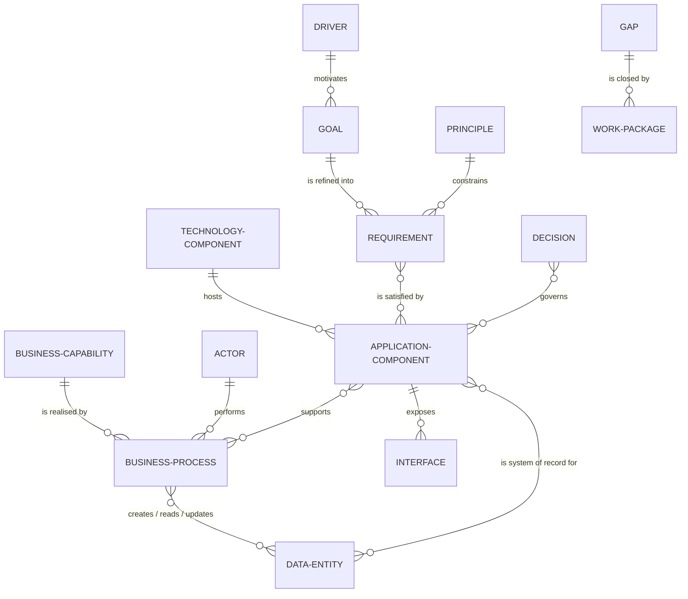

# Architecture Content Metamodel (Tailored)

| Status | Owner | Version | Last reviewed |
|---|---|---|---|
| Approved | Architecture Lead (Ops Lead) | 1.1 | 2026-04-02 |

## Purpose

The full TOGAF Content Framework is far larger than a 7-person business needs. This tailored metamodel keeps only the entities we actually maintain, so the repository stays small enough to keep current.

## Entities in scope

| Entity | TOGAF domain | Where it's catalogued |
|---|---|---|
| Driver, Goal | Motivation | [Architecture Vision](../02-architecture-landscape/strategic/architecture-vision.md) |
| Principle | Motivation | [Architecture Principles](../01-architecture-capability/architecture-principles.md) |
| Requirement | Motivation | [Requirements Catalogue](../06-architecture-requirements/requirements-catalog.md) |
| Business Capability, Value Stream, Process, Actor/Role | Business | [Business Architecture](../02-architecture-landscape/strategic/business-architecture.md) |
| Data Entity | Data | [Data Architecture](../02-architecture-landscape/strategic/data-architecture.md) |
| Application Component, Interface | Application | [Application Architecture](../02-architecture-landscape/strategic/application-architecture.md) |
| Technology Component | Technology | [Technology Architecture](../02-architecture-landscape/strategic/technology-architecture.md) |
| Gap, Work Package, Transition Architecture | Implementation & Migration | [Architecture Roadmap](../02-architecture-landscape/strategic/architecture-roadmap.md) |
| Decision | Governance | [Decision Log](../05-governance-log/decision-log.md) |

**Deliberately excluded:** Organisation Unit (one org unit), Location (one site), Service Quality and Measure as separate entities (we record them as attributes of Requirements), Logical vs Physical component split (we only model physical components, because almost all of them are SaaS).

## ID conventions

| Prefix | Entity | Example |
|---|---|---|
| `DRV-nn` | Driver | DRV-01 Engraving demand outgrowing manual process |
| `GOL-nn` | Goal | GOL-02 Ship 98% of orders same/next day |
| `PR-nn` | Principle | PR-03 Buy before build |
| `BC-nn` | Business Capability | BC-04 Order Fulfilment |
| `BP-nn` | Business Process | BP-03 Pick, pack & dispatch |
| `ACT-nn` | Actor / Role | ACT-02 Fulfilment Operative |
| `DE-nn` | Data Entity | DE-03 Order |
| `APP-nn` | Application Component | APP-01 Shopify |
| `INT-nn` | Interface | INT-02 Shopify → Xero |
| `TEC-nn` | Technology Component | TEC-03 Laser engraver |
| `REQ-nn` | Requirement | REQ-07 Card data must never touch our systems |
| `GAP-nn` | Gap | GAP-02 No real-time stock sync with Amazon |
| `WP-nn` | Work Package | WP-03 Engraving queue app |
| `ADR-nnn` | Architecture Decision | ADR-004 Adopt Shopify |
| `CA-yyyy-nnn` | Compliance Assessment | CA-2026-001 |
| `DSP-nnn` | Dispensation | DSP-001 |
