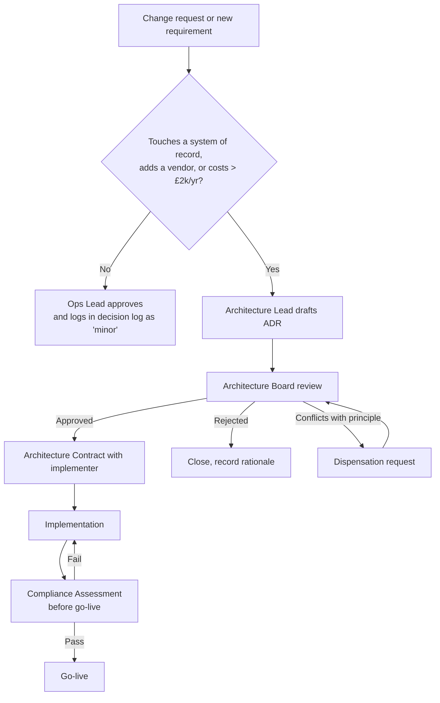

# Architecture Charter & Governance Framework

| Status | Owner | Version | Date |
|---|---|---|---|
| Approved | Managing Director | 1.2 | 2026-04-02 |

## Scope

The architecture function covers all business processes, data, applications and technology that Nib & Barrel Ltd uses to sell, fulfil and support orders. Out of scope: suppliers' internal systems, and the personal devices staff use outside work.

## Roles

At our size, architecture is a **part-time role** held by existing staff, not a separate department.

| Role | Held by | Responsibilities |
|---|---|---|
| Architecture Sponsor | Managing Director | Approves vision and budget, chairs the Architecture Board |
| Architecture Lead | Operations Lead | Maintains the repository, runs ADM cycles, drafts ADRs |
| Business Architect | Ops Lead + Customer Service Lead | Capabilities, processes, customer journeys |
| Data/Application/Technology Architect | External fractional consultant (2 days/month) | Integration design, vendor evaluation, technical reviews |
| Domain SME: Marketing | Marketing Manager | Customer data, consent, campaigns |
| Domain SME: Finance | Part-time Finance Manager | Accounting, VAT, payments |

## Architecture Board

- **Members:** MD (chair), Ops Lead, Finance Manager, fractional architect (advisory, non-voting)
- **Cadence:** Monthly (45 minutes), plus ad hoc when an ADR blocks delivery
- **Quorum:** MD + one other voting member
- **Decides:** Principles, ADRs, compliance assessments, dispensations, the roadmap
- **Records in:** [Governance Log](../05-governance-log/)

## Governance process

## Escalation

If the Board can't reach agreement, the MD decides and the dissent is recorded in the ADR.
