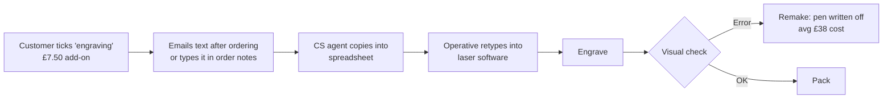
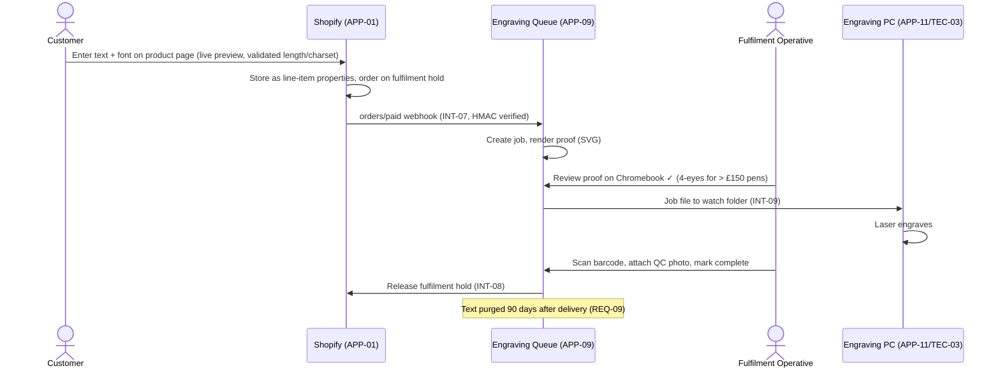
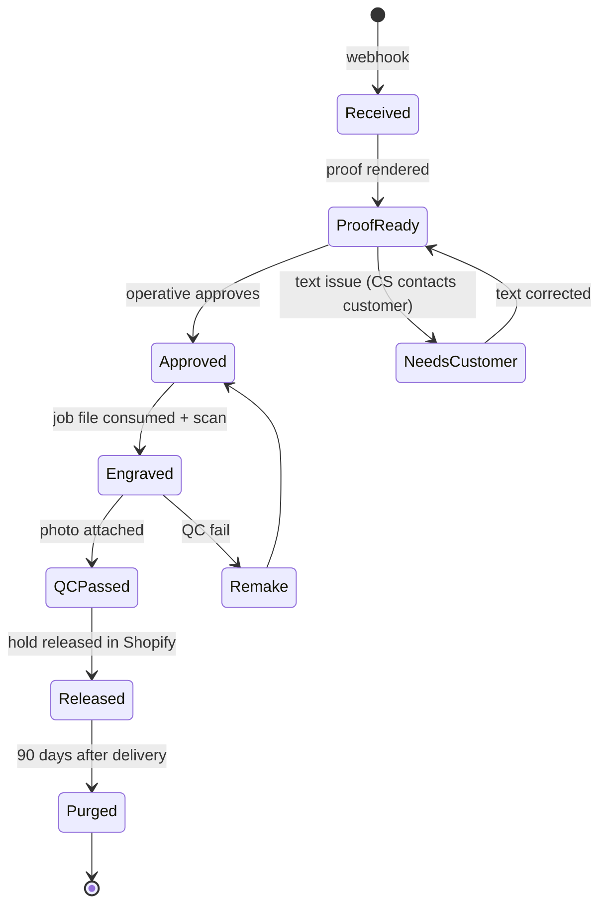

# Capability Architecture: BC-05 Personalisation (Engraving)

| Status | Owner | Version | Date |
|---|---|---|---|
| Approved | Architecture Lead + fractional architect | 1.2 | 2026-07-16 |

This is our only **custom-built** capability ([ADR-006](../../05-governance-log/decision-log.md#adr-006)), so it is documented in more detail than anything else.

## 1. Baseline process (2026-03)

**Problems:** three manual transcriptions, no preview, no font/length validation, no audit trail. 2.1% error rate, which is roughly 120 remakes a year (~£4.6k plus customer goodwill).

## 2. Target process

## 3. Application component design — APP-09 Engraving Queue

| Aspect | Decision |
|---|---|
| Purpose | Turn structured engraving specs into production jobs with proof, QC and an audit trail |
| Users | Fulfilment Operatives (ACT-02), Ops Lead (ACT-03) |
| Hosting | Cloudflare Workers + D1 (TEC-04), [ADR-007](../../05-governance-log/decision-log.md#adr-007) |
| Language | TypeScript |
| AuthN | Google SSO (Cloudflare Access) — no local passwords (REQ-12) |
| Data held | DE-05 only, plus order ID and SKU. No addresses or payment data. |
| Size budget | < 2,000 lines of code (keeps it maintainable by a single contractor) |
| Failure mode | If APP-09 is down, orders stay on hold in Shopify. Operatives can fall back to the Shopify order page and type the text manually, with 4-eyes checking. |

### Job state model

## 4. Requirements traced
REQ-01, REQ-02, REQ-03, REQ-09, REQ-12, REQ-14. See the [Requirements catalogue](../../06-architecture-requirements/requirements-catalog.md).

## 5. Building blocks
- **ABB:** Personalisation Workflow Service, Proof Renderer, Production Device Adapter
- **SBB:** see [Solutions Landscape — SBB-09](../../07-solutions-landscape/solution-building-blocks.md)
