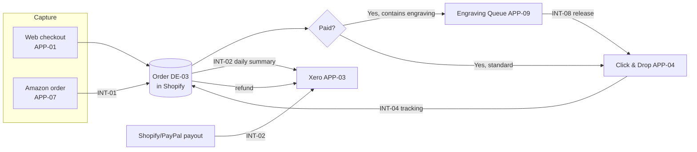

# Segment Architecture: Order-to-Cash

| Status | Owner | Version | Date |
|---|---|---|---|
| Approved | Architecture Lead | 1.0 | 2026-06-18 |

## Scope
From the moment a customer clicks **Buy** to the moment the money is reconciled in Xero, across both the web shop and Amazon. Covers BC-04, BC-06, BC-09 and the order-related parts of BC-03 and BC-08.

## Segment goals
| Measure | Baseline | Target |
|---|---|---|
| Order-to-dispatch (non-engraved) | 1.4 working days avg | ≤ 1 day for 98% |
| Manual touches per order | 4 (re-key ×3, check ×1) | 1 (physical pack only) |
| Payout reconciliation effort | 6 hrs/month | ≤ 1 hr/month |
| Refund-to-ledger lag | up to 30 days | same day |

## Target flow

## Baseline vs target (segment level)

| Step | Baseline | Target | Gap |
|---|---|---|---|
| Amazon order capture | Ops Lead copies into spreadsheet | Imported to Shopify automatically | GAP-02 |
| Stock decrement | Twice-daily manual update | Real-time in Shopify, pushed to Amazon ≤ 15 min | GAP-03 |
| Label creation | Re-keyed in Click & Drop | Auto-imported every 5 min | GAP-07 |
| Accounting | Daily totals typed into Xero | Daily summary journal + payout matching | GAP-06 |
| Refunds | Stripe dashboard + Xero by hand | Shopify refund → Xero credit note | GAP-06 |

## Segment-specific decisions
- [ADR-005](../../05-governance-log/decision-log.md#adr-005): post a daily **summary** to Xero rather than per-order invoices, to keep Xero within plan limits and make reconciliation easier.
