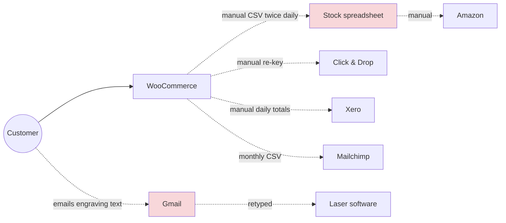

# Application Architecture (ADM Phase C — Application)

| Status | Owner | Version | Date |
|---|---|---|---|
| Approved | Fractional architect | 1.0 | 2026-06-04 |

## 1. Application portfolio catalogue

| ID | Application | Type | Capabilities | Baseline | Target | Annual cost (target) | Owner |
|---|---|---|---|---|---|---|---|
| APP-B1 | WooCommerce (+31 plugins) | Self-hosted OSS | BC-01,03,06 | In use | **Retire** (Q3 2026) | — | Ops Lead |
| APP-B2 | Stock spreadsheet (Google Sheets) | Spreadsheet | BC-03 | In use | **Retire** | — | Ops Lead |
| APP-B3 | Mailchimp | SaaS | BC-07 | In use | **Replace** → APP-05 | — | Marketing |
| APP-B4 | Shared Gmail inbox | SaaS | BC-08 | In use | **Replace** → APP-06 | — | CS Lead |
| APP-01 | Shopify (Advanced plan) | SaaS | BC-01,03,04,06,08 | — | **New** — core commerce | £3,500 | Ops Lead |
| APP-02 | Shopify Payments + PayPal | SaaS | BC-09 | Stripe + PayPal | **Replace/Keep** | ~1.5% + 20p per txn | Finance |
| APP-03 | Xero | SaaS | BC-09, BC-02 | In use | **Keep** | £600 | Finance |
| APP-04 | Royal Mail Click & Drop | SaaS | BC-04 | In use | **Keep** (re-integrate) | Free (per-label) | Ops Lead |
| APP-05 | Klaviyo | SaaS | BC-07, BC-10 | — | **New** | £1,400 | Marketing |
| APP-06 | Gorgias | SaaS | BC-08 | — | **New** | £1,100 | CS Lead |
| APP-07 | Amazon Seller Central | SaaS (channel) | BC-06 | In use | **Keep** | £300 + fees | Ops Lead |
| APP-08 | Marketplace connector (Shopify app) | SaaS | BC-06, BC-03 | — | **New** | £360 | Ops Lead |
| APP-09 | Engraving Queue | **Custom** (small web app) | BC-05 | — | **New** — build ([ADR-006](../../05-governance-log/decision-log.md#adr-006)) | £420 hosting + support retainer | Ops Lead |
| APP-10 | Google Workspace | SaaS | All (productivity, SSO) | In use | **Keep** | £900 | MD |
| APP-11 | Laser engraving software (vendor) | Desktop | BC-05 | In use | **Keep** (driven by APP-09 job files) | Included | Ops Lead |

## 2. Application context diagram — baseline (2026-03)

## 3. Interface catalogue (target)

| ID | Source → Target | Data | Mechanism | Frequency | Built/configured by |
|---|---|---|---|---|---|
| INT-01 | APP-01 ↔ APP-08 ↔ APP-07 | DE-01, DE-02 (out); DE-03 (in); DE-07 tracking (out) | Connector app (Amazon SP-API) | ≤ 15 min | Configure |
| INT-02 | APP-01 → APP-03 | Daily sales summary, fees, refunds, payouts | Official Xero app | Daily + per payout | Configure |
| INT-03 | APP-01 → APP-04 | Paid orders, addresses | Click & Drop Shopify integration | 5 min | Configure |
| INT-04 | APP-04 → APP-01 | Tracking numbers | Same integration | On label print | Configure |
| INT-05 | APP-01 → APP-05 | Customers, orders, consent, browse events | Native Klaviyo integration | Real-time | Configure |
| INT-06 | APP-01 → APP-06 | Order/customer context | Native Gorgias integration | Real-time | Configure |
| INT-07 | APP-01 → APP-09 | Paid orders containing engraving line items (`orders/paid` webhook) | HTTPS webhook, HMAC verified | Real-time | **Build** |
| INT-08 | APP-09 → APP-01 | Engraving complete → release fulfilment hold | Shopify Admin GraphQL API | On event | **Build** |
| INT-09 | APP-09 → APP-11 | Job file (text, font, coordinates) | File drop to engraving PC watch folder | Per job | **Build** |
| INT-10 | APP-01 → TEC-07 | Weekly data export | Scheduled export (Matrixify) | Weekly | Configure |

## 4. Application / function matrix

| Function | APP-01 | APP-02 | APP-03 | APP-04 | APP-05 | APP-06 | APP-07/08 | APP-09 |
|---|---|---|---|---|---|---|---|---|
| Catalogue & storefront | ● | | | | | | ○ | |
| Checkout & payment | ● | ● | | | | | ○ | |
| Inventory | ● | | | | | | ○ | |
| Engraving capture | ● | | | | | | | |
| Engraving production | | | | | | | | ● |
| Shipping labels | | | | ● | | | | |
| Accounting & VAT | | | ● | | | | | |
| Email/SMS marketing | | | | | ● | | | |
| Customer support | ○ | | | | | ● | | |

● primary · ○ secondary

## 5. Integration principles
1. Prefer the native/official integration (PR-03). A custom interface is allowed only for APP-09.
2. All custom webhooks verify the HMAC signature and are idempotent on Shopify order ID (REQ-14).
3. No interface may carry card data (REQ-07).
