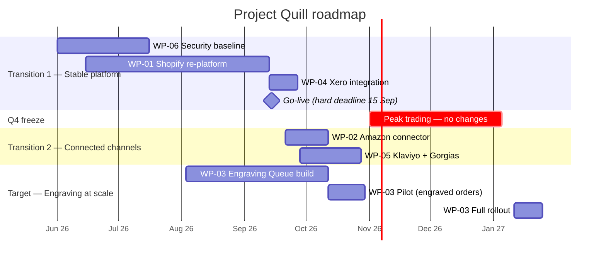

# Architecture Roadmap & Migration Plan (ADM Phases E & F)

| Status | Owner | Version | Date |
|---|---|---|---|
| Approved | Architecture Lead | 1.1 | 2026-07-02 |

## 1. Consolidated gap analysis

| ID | Gap | Domain | Baseline → Target | Closed by | Goal |
|---|---|---|---|---|---|
| GAP-01 | Fragile self-hosted web shop | App / Tech | WooCommerce on shared hosting → Shopify | WP-01 | GOL-04 |
| GAP-02 | No real-time stock sync with Amazon | Data / App | Manual → connector, ≤ 15 min | WP-02 | GOL-03 |
| GAP-03 | Inventory has three systems of record | Data | Spreadsheet + Woo + Amazon → Shopify only | WP-01, WP-02 | GOL-03 |
| GAP-04 | Engraving text retyped by hand | Business / App | Email → structured capture + queue + job file | WP-03 | GOL-01 |
| GAP-05 | No engraving preview for customers | Business / App | None → live preview on product page | WP-03 | GOL-01 |
| GAP-06 | Manual accounting entry | App | Daily re-key → Xero integration | WP-04 | GOL-05 |
| GAP-07 | Manual shipping entry | App | Re-key → Click & Drop integration | WP-01 | GOL-02, GOL-05 |
| GAP-08 | Support has no order context | App | Gmail → Gorgias | WP-05 | GOL-05 |
| GAP-09 | Consent records scattered; erasure untested | Data / Business | Mailchimp + Woo → Klaviyo + runbook | WP-05, WP-06 | GOL-06 |
| GAP-10 | No SSO/MFA consistency | Tech | Per-app passwords → Google SSO + MFA | WP-06 | PR-01 |
| GAP-11 | Single broadband line | Tech | → 4G failover | WP-06 | GOL-04 |

## 2. Work packages

| ID | Work package | Gaps | Approach | Est. cost | Owner |
|---|---|---|---|---|---|
| WP-01 | Re-platform to Shopify (incl. Click & Drop, redirects, payments) | 01, 03, 07 | Agency fixed-price + internal data cleansing | £18k | Ops Lead |
| WP-02 | Amazon marketplace connector | 02, 03 | Configure | £1k | Ops Lead |
| WP-03 | Engraving Queue + preview | 04, 05 | Contractor build ([AC-001](../../06-architecture-requirements/architecture-contracts/AC-001-engraving-queue.md)) | £12k | Ops Lead |
| WP-04 | Xero integration & payout reconciliation | 06 | Configure + accountant review | £1.5k | Finance |
| WP-05 | Klaviyo + Gorgias rollout | 08, 09 | Configure; migrate consent with provenance | £3k | Marketing / CS |
| WP-06 | Security & resilience baseline (SSO, MFA, failover, DSAR runbook) | 09, 10, 11 | Fractional architect + internal | £2.5k | Ops Lead |

## 3. Transition architectures

| Transition | Target date | Architecture state | Goals advanced |
|---|---|---|---|
| **T1: Stable platform** | 2026-09-14 | Shopify live; Click & Drop and Xero integrated; SSO/MFA on all apps; WooCommerce read-only for 90 days, then retired | GOL-02, GOL-04, GOL-05 (partial) |
| **T2: Connected channels** | 2026-10-31 | Amazon stock synced; Klaviyo replaces Mailchimp; Gorgias replaces shared inbox; consent consolidated | GOL-03, GOL-05, GOL-06 |
| **Target: Engraving at scale** | 2027-01-25 | Engraving Queue live for all engraved orders; preview on product pages. A pilot runs during October; the full rollout is deferred until after the Q4 freeze ([DSP-001](../../05-governance-log/dispensations.md)) | GOL-01 |

## 4. Dependencies & constraints
- WP-03 depends on WP-01, because it needs Shopify webhooks and line-item properties.
- WP-02 depends on WP-01, because Shopify must be the inventory system of record before the connector is switched on.
- **Q4 change freeze**, 1 Nov – 5 Jan: no production changes except security fixes.
