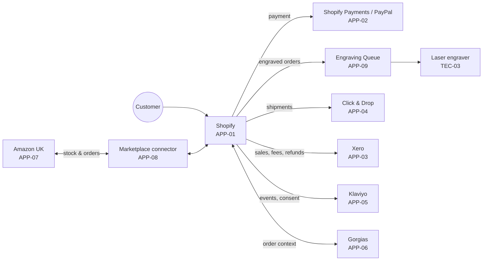

# Architecture Vision — Project Quill (ADM Phase A)

| Status | Owner | Version | Approved | Date |
|---|---|---|---|---|
| Approved | Architecture Lead | 1.0 | Architecture Board | 2026-04-23 |

## 1. Vision statement

> **Every pen arrives right, on time, and personal.** By the end of 2027, Nib & Barrel can handle twice its 2025 order volume, including engraved orders, with the same team size, no oversells and no re-keyed data.

## 2. Business drivers

| ID | Driver | Evidence |
|---|---|---|
| DRV-01 | Engraving demand is outgrowing the manual process | Engraving grew from 9% to 22% of orders (2023→2025). Error rate is 2.1% because the text is retyped from emails into the laser software. |
| DRV-02 | Stock is oversold across channels | 41 oversells in 2025. Amazon stock is updated by hand twice a day. |
| DRV-03 | The web platform is fragile at peak | WooCommerce was down for 6 hours on Black Friday 2025 (est. £14k lost). 31 plugins, 4 of them abandoned. |
| DRV-04 | Admin overhead is too high | About 20 hrs/week spent re-keying orders into Xero, Click & Drop and spreadsheets. |
| DRV-05 | Regulatory exposure | Consent records are scattered, and there is no tested data-deletion process (UK GDPR Art. 17). |

## 3. Goals and measures

| ID | Goal | Measure | Baseline (2025) | Target (Q4 2027) | Drivers |
|---|---|---|---|---|---|
| GOL-01 | Accurate, fast engraving | Engraving error rate / turnaround | 2.1% / 4 days | < 0.3% / ≤ 2 working days | DRV-01 |
| GOL-02 | Fast dispatch | % non-engraved orders shipped same/next working day | 91% | 98% | DRV-03, DRV-04 |
| GOL-03 | No oversells | Oversell incidents per year | 41 | 0 | DRV-02 |
| GOL-04 | Resilient peak trading | Web shop availability, Nov–Dec | 99.1% | 99.9% | DRV-03 |
| GOL-05 | Less admin | Hours/week spent on manual data entry | ~20 | ≤ 5 | DRV-04 |
| GOL-06 | Demonstrable compliance | Days to fulfil a data-subject request (DSAR/erasure) | untested | ≤ 7 days, tested quarterly | DRV-05 |

## 4. Scope

**In scope:** web shop platform, inventory, order management, engraving workflow, shipping, accounting integration, customer service tooling, email marketing, consent management.
**Out of scope (this cycle):** EU expansion, wholesale/B2B channel, physical retail, ERP.

## 5. Stakeholder map

| Stakeholder | Concern | Influence | Interest | Engagement | Key viewpoints |
|---|---|---|---|---|---|
| Managing Director | Growth, cost, risk | High | High | Manage closely | Vision, roadmap, cost |
| Operations Lead | Throughput, accuracy | High | High | Manage closely | Process, application |
| Fulfilment team | Usable tools, fewer errors | Low | High | Keep informed + involve in UAT | Process, engraving workflow |
| Customer Service | Order visibility, fast answers | Medium | High | Keep informed | Application, data |
| Marketing Manager | Customer data, segmentation | Medium | Medium | Keep satisfied | Data, consent |
| Finance Manager | Accurate ledgers, VAT, cash | Medium | Medium | Keep satisfied | Data, integration |
| Customers | Correct, timely, personal orders; privacy | High (collectively) | High | Monitor via reviews/NPS | Customer journey |
| Fractional architect | Coherent, maintainable design | Low | Medium | Consult | All |

## 6. Target architecture at a glance

## 7. Business value and cost (summary)

| Item | Estimate |
|---|---|
| One-off cost (migration, custom engraving app, contractor time) | £38k |
| Recurring SaaS delta vs baseline | +£6.2k / year |
| Benefits: admin time saved (15 hrs/wk × £16/hr) | £12.5k / year |
| Benefits: avoided peak outage + oversells + engraving remakes | ~£24k / year |
| **Payback** | **~17 months** |

## 8. Key risks

| Risk | Likelihood | Impact | Mitigation |
|---|---|---|---|
| SEO ranking drop after migration | Medium | High | 301 redirect map, URL parity testing (WP-01) |
| Migration slips into Q4 freeze | Medium | High | Hard cut-off: go-live by 2026-09-15, otherwise defer to Jan 2027 |
| Custom engraving app becomes unmaintained | Low | Medium | Keep it small; source in company GitHub; contract includes handover docs ([AC-001](../../06-architecture-requirements/architecture-contracts/AC-001-engraving-queue.md)) |
| Staff adoption | Low | Medium | Fulfilment team in UAT; laminated quick guides at stations |

## 9. Approval

Statement of Architecture Work approved by the Architecture Board on 2026-04-23 ([ADR-003](../../05-governance-log/decision-log.md#adr-003)).
