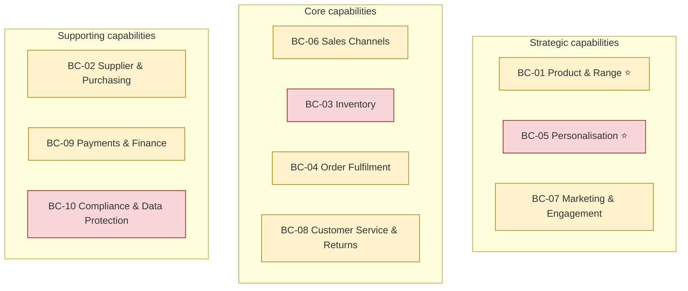
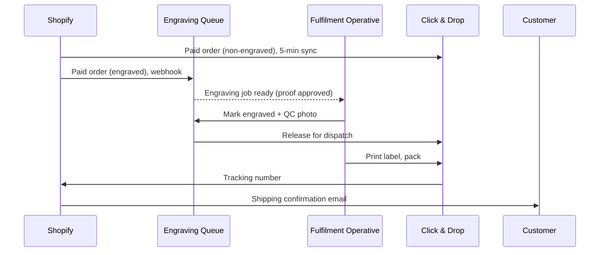

# Business Architecture (ADM Phase B)

| Status | Owner | Version | Date |
|---|---|---|---|
| Approved | Business Architect (Ops Lead) | 1.0 | 2026-05-14 |

## 1. Business capability map

Heat-map: 🟢 adequate · 🟡 needs improvement · 🔴 critical gap (baseline assessment). ⭐ = strategic differentiator.

| ID | Capability | Baseline | Target | Notes |
|---|---|---|---|---|
| BC-01 | Product & Range Management ⭐ | 🟡 | 🟢 | Curation is what sets us apart; product data is split between WooCommerce and spreadsheets |
| BC-02 | Supplier & Purchasing | 🟡 | 🟡 | Purchase orders sent as email + spreadsheet; acceptable for now |
| BC-03 | Inventory Management | 🔴 | 🟢 | Three copies of stock; causes oversells (DRV-02) |
| BC-04 | Order Fulfilment | 🟡 | 🟢 | Click & Drop is fine; orders are re-keyed |
| BC-05 | Personalisation (Engraving) ⭐ | 🔴 | 🟢 | Manual, error-prone, growing fast (DRV-01) |
| BC-06 | Sales Channel Management | 🟡 | 🟢 | Amazon is managed by hand |
| BC-07 | Marketing & Customer Engagement | 🟡 | 🟢 | Mailchimp is not connected to purchase data |
| BC-08 | Customer Service & Returns | 🟡 | 🟢 | Shared Gmail inbox; no order context |
| BC-09 | Payments & Finance | 🟡 | 🟢 | Daily manual Xero entry |
| BC-10 | Compliance & Data Protection | 🔴 | 🟢 | Consent scattered; erasure untested (DRV-05) |

## 2. Value stream: "Gift that Delights"

| Stage | Discover | Choose & Personalise | Buy | Make & Pack | Deliver | Support & Return |
|---|---|---|---|---|---|---|
| **Customer value** | Find the right pen | Confidence it will look right | Quick, safe checkout | Made correctly | Arrives on time | Problems fixed fast |
| **Capabilities** | BC-01, BC-07 | BC-01, BC-05 | BC-06, BC-09 | BC-03, BC-04, BC-05 | BC-04 | BC-08, BC-09 |
| **Target applications** | APP-01, APP-05 | APP-01 (+ preview) | APP-01, APP-02 | APP-09, APP-04 | APP-04 | APP-06, APP-01 |
| **Pain (baseline)** | — | No preview; free-text box | Site outage at peak | Retyping engraving text | — | No order context in inbox |

## 3. Actor / role catalogue

| ID | Actor / Role | Type | Description |
|---|---|---|---|
| ACT-01 | Customer | External | Buys for self or as gift; ~62% repeat within 2 years |
| ACT-02 | Fulfilment Operative | Internal (2 FTE, +2 seasonal) | Picks, engraves, packs, dispatches |
| ACT-03 | Operations Lead | Internal | Inventory, purchasing, process owner, Architecture Lead |
| ACT-04 | Customer Service Agent | Internal | Enquiries, returns, refunds |
| ACT-05 | Marketing Manager | Internal | Campaigns, content, consent |
| ACT-06 | Finance Manager | Internal (0.4 FTE) | Reconciliation, VAT, payroll |
| ACT-07 | Supplier | External | 18 pen and ink manufacturers/distributors |
| ACT-08 | Carrier | External | Royal Mail (primary), DPD (high value / next day) |
| ACT-09 | Marketplace | External | Amazon UK |

## 4. Business process catalogue

| ID | Process | Owner | Capability | Frequency | Target change |
|---|---|---|---|---|---|
| BP-01 | Onboard new product | ACT-03 | BC-01 | ~15/month | Single product record in Shopify syndicated to Amazon |
| BP-02 | Purchase & receive stock | ACT-03 | BC-02, BC-03 | Weekly | Receive against PO in Shopify; stock updates all channels |
| BP-03 | Pick, pack & dispatch | ACT-02 | BC-04 | ~100/day (300 peak) | Orders flow automatically to Click & Drop |
| BP-04 | Engrave order | ACT-02 | BC-05 | ~22/day (70 peak) | See [capability architecture](../capability/personalised-engraving.md) |
| BP-05 | Handle return / refund | ACT-04 | BC-08, BC-09 | ~6/day | Self-serve returns portal; refund syncs to Xero |
| BP-06 | Month-end close | ACT-06 | BC-09 | Monthly | Automated payout reconciliation |
| BP-07 | Run campaign | ACT-05 | BC-07 | ~6/month | Purchase-based segments in Klaviyo |
| BP-08 | Handle customer enquiry | ACT-04 | BC-08 | ~40/day | Helpdesk with order sidebar and macros |
| BP-09 | Fulfil data-subject request | ACT-04 + ACT-03 | BC-10 | ~2/month | Documented runbook across all systems |

## 5. Business process: BP-03 Pick, pack & dispatch (target)

## 6. Organisation impact

No new roles. In peak season, one seasonal operative is trained only on the engraving station, because the new queue removes the need to read customer emails.
