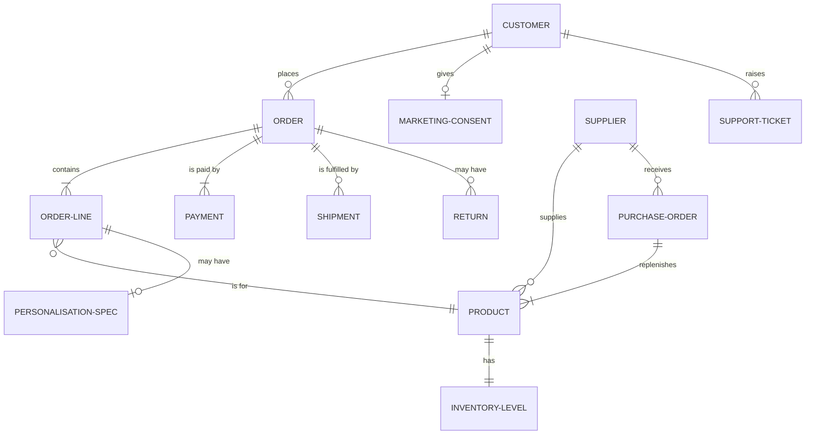

# Data Architecture (ADM Phase C — Data)

| Status | Owner | Version | Date |
|---|---|---|---|
| Approved | Fractional architect | 1.0 | 2026-05-28 |

## 1. Data entity catalogue

| ID | Entity | Description | Classification | System of record (baseline) | System of record (target) | Retention |
|---|---|---|---|---|---|---|
| DE-01 | Product | SKU, title, description, images, attributes (nib size, fill system, colour) | Public | WooCommerce + spreadsheet ⚠️ | APP-01 Shopify | Life of product + 2 yrs |
| DE-02 | Inventory Level | On-hand / committed quantity per SKU | Internal | Spreadsheet ⚠️ (3 copies) | APP-01 Shopify | Rolling |
| DE-03 | Order | Header, lines, totals, channel | Confidential | WooCommerce / Amazon | APP-01 Shopify (Amazon orders imported) | 6 yrs (HMRC) |
| DE-04 | Customer | Name, email, addresses, order history | Personal (UK GDPR) | WooCommerce + Mailchimp ⚠️ | APP-01 Shopify | 3 yrs after last order, then anonymise |
| DE-05 | Personalisation Spec | Engraving text, font, position, proof status | Personal (may contain names/dates) | Email inbox ⚠️ | APP-09 Engraving Queue | 90 days after delivery |
| DE-06 | Payment | Transaction reference, amount, status (**no card data**) | Confidential | Stripe / PayPal | APP-02 Shopify Payments / PayPal | 6 yrs |
| DE-07 | Shipment | Carrier, service, tracking number, status | Internal | Click & Drop | APP-04 Click & Drop | 2 yrs |
| DE-08 | Supplier | Contact details, terms, lead time | Internal | Spreadsheet | APP-03 Xero (contacts) | Life of relationship + 6 yrs |
| DE-09 | Purchase Order | Lines, expected date, received qty | Internal | Email + spreadsheet | APP-01 Shopify (purchase orders) | 6 yrs |
| DE-10 | Return | Reason, condition, refund/exchange outcome | Confidential | Gmail | APP-01 Shopify (returns) | 6 yrs |
| DE-11 | Marketing Consent | Opt-in status, source, timestamp | Personal (PECR) | Mailchimp + WooCommerce ⚠️ | APP-05 Klaviyo (synced from Shopify checkout) | Until withdrawn + 2 yrs proof |
| DE-12 | Ledger Entry | Sales, fees, refunds, VAT | Confidential | Xero | APP-03 Xero | 6 yrs |
| DE-13 | Support Ticket | Conversation with customer | Personal | Gmail | APP-06 Gorgias | 2 yrs |

⚠️ = breaks [PR-02](../../01-architecture-capability/architecture-principles.md) (one system of record) in the baseline.

## 2. Conceptual data model (target)

## 3. Application / data CRUD matrix (target)

C = create · R = read · U = update · D = delete. **Bold** = system of record.

| Entity | APP-01 Shopify | APP-02 Payments | APP-03 Xero | APP-04 Click & Drop | APP-05 Klaviyo | APP-06 Gorgias | APP-07/08 Amazon + connector | APP-09 Engraving Queue |
|---|---|---|---|---|---|---|---|---|
| DE-01 Product | **CRUD** | | R | R | R | R | R | R |
| DE-02 Inventory | **CRUD** | | | | | | R | |
| DE-03 Order | **CRUD** | R | R | R | R | R | C (import) | R |
| DE-04 Customer | **CRUD** | R | R | R | R | R | | |
| DE-05 Personalisation | C (capture) | | | | | R | | **RU** (+D after 90d) |
| DE-06 Payment | R | **CRU** | R | | | R | | |
| DE-07 Shipment | R | | | **CRU** | R | R | U (tracking) | R |
| DE-11 Consent | C (checkout) | | | | **RUD** | | | |
| DE-12 Ledger | | | **CRUD** | | | | | |
| DE-13 Ticket | | | | | | **CRUD** | | |

## 4. Data principles applied
- **Minimisation:** Engraving text is deleted 90 days after delivery (REQ-09). Card data never enters our estate (REQ-07).
- **Exportability:** DE-01, DE-03 and DE-04 are exported weekly as CSV/JSON to company storage (PR-06, TEC-07).
- **Erasure:** A data-subject request is actioned in Shopify first, then propagated to Klaviyo, Gorgias and the Engraving Queue (runbook BP-09). Xero and order records are retained for 6 years under a legal-obligation basis.
