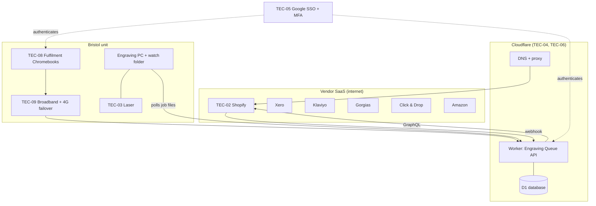

# Technology Architecture (ADM Phase D)

| Status | Owner | Version | Date |
|---|---|---|---|
| Approved | Fractional architect | 1.0 | 2026-06-11 |

Most of our technology is SaaS, so this document focuses on the **few components we operate ourselves** and the platform services we depend on.

## 1. Technology component catalogue

| ID | Component | Category (TRM) | Hosts / supports | Baseline | Target | SIB ref |
|---|---|---|---|---|---|---|
| TEC-01 | Shared PHP hosting (cPanel) | Platform / hosting | APP-B1 | In use | **Retire** | — |
| TEC-02 | Shopify platform (multi-tenant SaaS) | Platform (vendor-managed) | APP-01 | — | **New** | STD-01 |
| TEC-03 | Laser engraver (30W fibre) + Windows 11 PC | Physical device / endpoint | APP-11 | In use | **Keep** | STD-09 |
| TEC-04 | Serverless app hosting (Cloudflare Workers + D1) | Platform (PaaS) | APP-09 | — | **New** | STD-04 |
| TEC-05 | Google Workspace identity (SSO + MFA) | Security / identity | All SaaS that supports SAML/OIDC | Partial | **Standard** | STD-05 |
| TEC-06 | Domain & DNS (Cloudflare) | Network | Storefront, email | In use (registrar DNS) | **Migrate** to Cloudflare | STD-06 |
| TEC-07 | Backup storage (Google Drive shared drive, restricted) | Storage | Weekly data exports | — | **New** | STD-07 |
| TEC-08 | Fulfilment station endpoints (2× Chromebooks, label printers, barcode scanners) | End-user devices | APP-04, APP-09 | Laptops (mixed) | **Standardise** | STD-08 |
| TEC-09 | Office broadband + 4G failover router | Network | All | Single line | **Add failover** | — |

## 2. Technology environment diagram (target)

## 3. Non-functional characteristics

| Concern | Approach | Requirement |
|---|---|---|
| Availability | Shopify SLA 99.99% storefront; Engraving Queue degrades gracefully (orders hold in Shopify until processed) | REQ-10 |
| Scalability | All components scale by vendor/usage; Workers auto-scale | REQ-11 |
| Security | SSO+MFA, least privilege per app, no card data in estate, webhook HMAC | REQ-07, REQ-12, REQ-14 |
| Backup & recovery | Weekly export (TEC-07); Engraving Queue D1 point-in-time recovery (30 days) | REQ-13 |
| Office outage | 4G failover; Shopify and CS tools usable from home; engraving is the only on-site dependency | REQ-10 |
