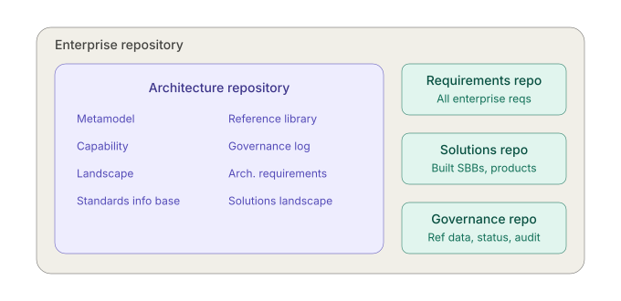
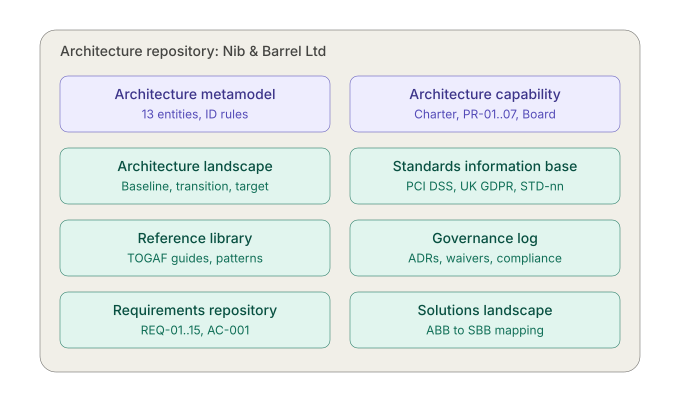
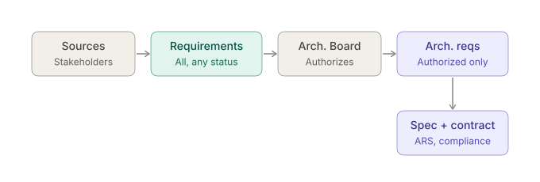
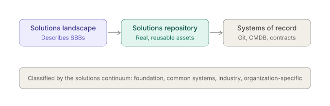
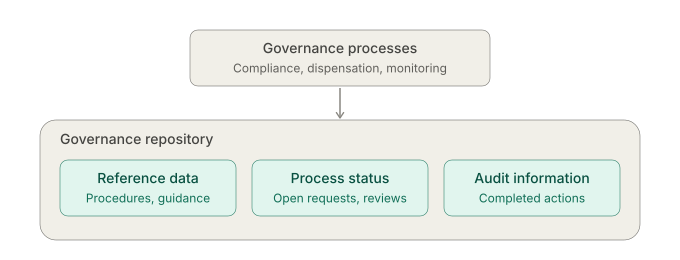

# Nib & Barrel Ltd — TOGAF Enterprise Repository

> **Example only.** Nib & Barrel Ltd is a fictional UK online retailer of fountain pens, ballpoints, inks and refills, with an optional laser-engraving service. This repository shows how a small business could organise its architecture work using the **TOGAF Standard, 10th Edition** Architecture Repository.

## What's in this repository

| Folder | TOGAF repository | Start with |
|---|---|---|
| [`architecture-repository/`](architecture-repository/) | Architecture Repository (metamodel, capability, landscape, SIB, reference library, governance log, architecture requirements, solutions landscape) | [README](architecture-repository/README.md) |
| [`requirements-repository/`](requirements-repository/) | Requirements Repository: every requirement in any status, change requests, impact statements, traceability | [README](requirements-repository/README.md) |
| [`solutions-repository/`](solutions-repository/) | Solutions Repository: the real assets (configuration baselines, custom code index, contracts, runbooks), classified by the Solutions Continuum | [README](solutions-repository/README.md) |
| [`governance-repository/`](governance-repository/) | Governance Repository: reference data (policies, procedures), process status (open requests), audit information (minutes, evidence) | [README](governance-repository/README.md) |

All four describe the same moment: **2026-10-19**, during Phase G of ADM cycle 2 ("Project Quill"). Shopify is live, the engraving pilot is running, and the Q4 change freeze starts on 1 November. They link to each other by stable ID (see the [ID conventions](architecture-repository/00-architecture-metamodel/content-metamodel.md#id-conventions)). One thread to follow across all four is engraving:
RQ-003 (requirements) → REQ-01 and ADR-006 (architecture) → SA-30 Engraving Queue (solutions) → CA-2026-002 and its open condition GA-003 (architecture governance log and governance repository).

## TOGAF repositories

> what repositories are used in TOGAF



- **Architecture repository:** the core one, holding everything the architecture function produces and governs.
- **Enterprise repository:** an umbrella concept, not a separate tool. It groups the architecture repository with the requirements and solutions repositories.
- **Requirements repository vs architecture requirements repository:** the first holds all business and project requirements. The second holds only the architecturally significant subset.
- **Solutions repository vs solutions landscape:** the first holds the actual implemented solutions and products. The second is the architectural *description* of them, i.e. the SBBs.
- **Governance repository:** described in TOGAF's architecture governance chapter. It holds reference data, process status and audit information that support compliance and dispensations.
- **Enterprise Continuum:** not a repository but a classification scheme for repository content, from generic to specific: Foundation, Common Systems, Industry, Organization-specific.
- **Version naming:** TOGAF 9.2 calls one component the Standards Information Base. I'm not sure whether the TOGAF 10 text renames it, so check the edition you're working from.
- **Anti-pattern:** physically building all of these as separate tools. That creates copies that drift apart and SPOFs at each integration point. Use one store with typed sections and links, and keep requirements and solutions in their systems of record (backlog, CMDB), referenced by ID.

## TOGAF Architecture Repository

> Explain each TOGAF Architecture Repository component in detail

| Component | Purpose | Key content and structure | Created / updated | Nib & Barrel example |
|---|---|---|---|---|
| **Architecture metamodel** | The organization's tailored version of the framework | Tailored ADM process, tailored content metamodel (entities, attributes, relationships), viewpoint definitions | Preliminary phase; changes rarely, through governance | [Tailored metamodel](architecture-repository/00-architecture-metamodel/content-metamodel.md) of 13 entity types with stable ID prefixes; [ADM tailored](architecture-repository/01-architecture-capability/tailored-adm.md) to an 8–12 week part-time cycle |
| **Architecture capability** | How the EA function itself operates and governs the repository | EA charter, organizational model for EA, roles and skills, Architecture Board terms of reference, templates and tooling. Principles are commonly kept here. | Preliminary; revisited per ADM cycle | Ops Lead as part-time Architecture Lead plus a fractional architect; the Board is MD (chair), Ops Lead and Finance Manager ([charter](architecture-repository/01-architecture-capability/architecture-charter.md)); [PR-03](architecture-repository/01-architecture-capability/architecture-principles.md) "Buy before build" |
| **Architecture landscape** | Architectural view of assets in use or planned at a point in time | Three levels: strategic (long-term direction), segment (programme or portfolio), capability (project-level detail). Each has baseline, transition and target states, made up of catalogs, matrices and diagrams across business, data, application and technology. | Phases B–F; Phase H on change | Baseline: WooCommerce + stock spreadsheet. T1: Shopify live 2026-09-14. Target: engraving at scale, 2027-01 ([roadmap](architecture-repository/02-architecture-landscape/strategic/architecture-roadmap.md)) |
| **Standards information base (SIB)** | Standards the architecture must comply with | Three types: legal/regulatory, industry, organizational. Each standard has a lifecycle state: trial, active, deprecated, obsolete. | Continuously; reviewed by the Board | [LEG-03](architecture-repository/03-standards-information-base/legal-and-regulatory.md) PCI DSS SAQ A, LEG-01 UK GDPR; [STD-01](architecture-repository/03-standards-information-base/technology-standards.md) Shopify (Adopt), STD-01a WooCommerce (Retire), STD-02a card data on our systems (Prohibited) |
| **Reference library** | Reusable reference material | Reference architectures, patterns, templates, guidelines, viewpoint library, external models; classified by the Enterprise Continuum | Ad hoc, as material is adopted | [RL-02](architecture-repository/04-reference-library/reference-models.md) TOGAF Business Capabilities guide, the ADR template, PAT-02 webhook hold-and-release pattern |
| **Governance log** | Evidence trail of governance | Decision log, compliance assessments, capability assessments, dispensations (waivers), calendar, project portfolio, performance measures | Every Board meeting, review and waiver | [ADR-004](architecture-repository/05-governance-log/decision-log.md#adr-004) re-platform to Shopify; [DSP-001](architecture-repository/05-governance-log/dispensations.md) manual engraving transcription until 2027-01-31; CA-2026-001 pre-go-live review |
| **Architecture requirements repository** | Requirements the Board has authorized | Constraints, NFRs, gap-derived requirements, implementation specifications, contract conformance criteria | Phases A–F, with Requirements Management; Phase H | [REQ-07](architecture-repository/06-architecture-requirements/requirements-catalog.md) card data never enters our systems; REQ-01 live engraving preview; REQ-10 storefront ≥ 99.9% in Nov–Dec |
| **Solutions landscape** | Architectural view of the SBBs that realize the architecture landscape | ABB→SBB mapping, planned and deployed SBBs, interfaces, lifecycle state | Phases E–G | Commerce Engine ABB → [SBB-01](architecture-repository/07-solutions-landscape/solution-building-blocks.md) Shopify; Personalisation Workflow Service ABB → SBB-09 custom Engraving Queue |

Key relationships:
- The metamodel defines the types, and all other content must conform to it.
- The SIB and reference library feed the landscape. The landscape must comply with the SIB and should reuse the reference library.
- Architecture requirements drive the target landscape. The solutions landscape realizes it, and the governance log records the evidence.
- The capability component governs the whole repository.

Risks and anti-patterns:
- **Over-tailored or undocumented metamodel.** Teams model the same thing differently and repository queries return garbage. Freeze it and change it only through ADRs.
- **SIB with no lifecycle states.** Deprecated standards stay in use with no trigger to migrate them. Add review dates.
- **Governance log kept in email or meeting notes.** The evidence is lost, so compliance can't be shown to an auditor. Keep it append-only and versioned.
- **Landscape without a date or state.** Mixing baseline and target in one view makes gap analysis impossible. Every view needs a state and an effective date.
- **SPOF.** If one person or tool licence holds the repository, it is lost when they go. Use Git or an export-capable tool, with backups and access control: write access for architects only, read access for delivery teams.


### Example Architecture Repository

> Can you give me an example of Architecture Repository for simple ecommerce business selling pens



The Nib & Barrel [Architecture Repository](architecture-repository/README.md), laid out as a Git-backed repository:

```
architecture-repository/
├─ 00-architecture-metamodel/     content-metamodel.md  (13 entity types, ID conventions DRV-, GOL-, PR-, BC-, DE-, APP-, REQ-, ADR- …)
├─ 01-architecture-capability/    architecture-charter.md, architecture-principles.md, tailored-adm.md, capability-maturity.md
│    └─ PR-01 "Customer trust comes first", PR-02 "One system of record per data entity", PR-03 "Buy before build" … PR-07
├─ 02-architecture-landscape/     baseline (2026-03) and target (end 2027) side by side in each document
│  ├─ strategic/                  vision, business (BC-01..10, value stream), data (DE-01..13, CRUD matrix),
│  │                              application (APP-01..11, INT-01..10), technology (TEC-01..09), roadmap (GAP, WP, T1/T2/target)
│  ├─ segment/                    order-to-cash.md
│  └─ capability/                 personalised-engraving.md  (the only custom-built capability)
├─ 03-standards-information-base/ legal-and-regulatory.md (LEG-01..08: UK GDPR, PECR, PCI DSS SAQ A …),
│                                 technology-standards.md (STD-01..12, Trial → Adopt → Contain → Retire → Prohibited)
├─ 04-reference-library/          reference-models.md (RL-01..09, PAT-01..03), templates/ (ADR, compliance assessment, vendor evaluation)
├─ 05-governance-log/             decision-log.md (ADR-001..008), dispensations.md (DSP-001..002),
│                                 compliance-assessments/ (CA-2026-001 Shopify re-platform, CA-2026-002 engraving pilot)
├─ 06-architecture-requirements/  requirements-catalog.md (REQ-01..15, each linked to its RQ- source record),
│                                 architecture-contracts/AC-001-engraving-queue.md
└─ 07-solutions-landscape/        solution-building-blocks.md (ABB → SBB-01..13, retirement plan for legacy SBBs)
```

Pushback:
- **The full TOGAF repository is overkill here.** For a pen shop, keep principles, the target landscape catalogs, ADRs, NFRs and the ABB→SBB map, and drop the rest until you have more than about 10 systems or more than 1 team. Nib & Barrel keeps all eight components, but each one is only one or two short files.
- **The repository is a single point of failure for decisions.** If it lives in one person's tool or tenant, it goes when they do. Keep it in Git with PR review, so it is versioned and auditable.
- **Security risk:** never store real PII, API keys or PSP credentials in the repository. Model the entities only, and reference secrets by vault path.
- **Data integrity risk:** maintaining both catalogs and diagrams by hand will drift apart. Make the CSV/YAML the source of truth and generate the diagrams from it, for example with Mermaid or Structurizr.

## TOGAF requirements repository

> What is the TOGAF Requirements repository?

- **Definition:** one of the three repositories in TOGAF's enterprise repository, alongside the architecture repository and the solutions repository. It is the store used by the Requirements Management process to record and manage *all* requirements across the ADM cycle.
- **Scope:** every requirement, from any source, in any state. It is not limited to architecturally significant or Board-approved ones; that subset is the architecture requirements repository.
- **Typical content:**
  - business, functional and non-functional requirements;
  - constraints and assumptions;
  - regulatory obligations;
  - stakeholder concerns;
  - requirements raised by change requests and by gap analysis.
- **Minimum attributes per record:**
  - ID, statement and rationale;
  - source or stakeholder, and owner;
  - type and priority;
  - status: proposed, analysed, approved, deferred, rejected, implemented or superseded;
  - affected ADM phases and building blocks;
  - links to the source ticket, change request, ADR and architecture requirement (if promoted);
  - acceptance criteria;
  - change history.
- **Who reads and writes it:**
  - **Every ADM phase:** each phase adds and consumes requirements.
  - **Requirements Management:** assesses impact and controls status.
  - **Architecture Board:** promotes requirements to the architecture requirements repository.
  - **Delivery teams:** implement them.
- **Nib & Barrel examples** (see the [requirements register](requirements-repository/03-requirements-register/register.md)):
  - [RQ-018](requirements-repository/03-requirements-register/records/RQ-018-gift-wrapping.md) "Gift wrapping" was proposed, then approved for delivery only (a Shopify product add-on, no architecture change).
  - [RQ-005](requirements-repository/03-requirements-register/records/RQ-005-engraving-without-retyping.md) "Engraving text reaches the laser without retyping" was approved as architecturally significant and led to ADR-006 and the Engraving Queue.
  - [RQ-033](requirements-repository/03-requirements-register/records/RQ-033-store-card-details.md) "Store customers' card details for one-click reorder" was rejected, with the reason kept (REQ-07, STD-02a).

Implementation guidance:
- **Avoid a separate tool alongside the backlog.** If it duplicates your issue tracker, the two diverge and it becomes shelfware. Use the existing backlog as the requirements repository, with a type field, a status workflow and mandatory triage labels.
- **Keep it append-only.** Never delete rejected or superseded entries; change their status. Deleting them breaks traceability and invites the same requests again.
- **Data-integrity risk:** without stable IDs and enforced links (requirement ↔ change request ↔ ADR ↔ building block), impact analysis in Phase H is guesswork.
- **Security:** requirements often contain sensitive business or security details, such as vulnerability-driven NFRs. Apply role-based access, not open-to-all.

### Requirements repository vs architecture requirements

> What goes in the TOGAF requirements repository vs architecture requirements repository?



**Requirements repository** (part of the enterprise repository):
- Holds every requirement captured during the ADM by Requirements Management: business, functional, non-functional, regulatory, operational and project.
- Includes every status: proposed, under analysis, deferred, rejected and superseded.
- Is dynamic: requirements can be added or changed in any ADM phase.
- Records the source, owner, priority, rationale and status history of each requirement.

**Architecture requirements repository** (part of the architecture repository):
- Holds only the requirements the Architecture Board has authorized and agreed. This is the binding set the architecture must satisfy.
- Typical content:
  - constraints, assumptions and NFRs (availability, security, performance);
  - interoperability and interface requirements;
  - requirements derived from gap analysis in Phases B–D;
  - implementation guidelines and specifications, plus conformance criteria for the architecture contract.
- Is baselined and versioned, and changes only through Phase H change requests.
- Feeds the Architecture Requirements Specification deliverable and the compliance reviews.

**Nib & Barrel examples:**

| Requirement | [Requirements repo](requirements-repository/) | [Arch. requirements repo](architecture-repository/06-architecture-requirements/requirements-catalog.md) |
|---|---|---|
| "Add gift wrapping option" | ✓ RQ-018 (delivery only) | ✗ |
| "Validate engraving text: max length per SKU, supported characters" | ✓ RQ-004 | ✓ REQ-02, new capability and data attribute (DE-05) |
| "Storefront ≥ 99.9% available in Nov–Dec" | ✓ RQ-008 | ✓ REQ-10, NFR |
| "Card data never enters our systems" (PCI DSS SAQ A) | ✓ RQ-023 | ✓ REQ-07, constraint |
| "Sell to EU customers" | ✓ RQ-030 deferred to ADM cycle 3 | ✗ |
| "Store customers' card details for one-click reorder" | ✓ RQ-033 rejected | ✗ |

**Rules:**
- **Copy direction:** an architecture requirement should reference its source record by ID, not copy it. Two editable copies will diverge.
- **Rejected or deferred requirements:** keep them in the requirements repository with a reason. Deleting them loses the audit trail and the same requests come back.
- **Approval gate:** no requirement enters the architecture requirements repository without Architecture Board sign-off. Otherwise it stops being a governed baseline and becomes a wishlist.

## TOGAF solutions repository

> What is the TOGAF solutions repository?



- **Definition:** one of the three repositories inside TOGAF's enterprise repository, alongside the architecture repository and the requirements repository. It holds the actual solution assets that implement the architecture, not descriptions of them.
- **Typical content:**
  - deployed and reusable SBBs (products, packages, SaaS subscriptions);
  - custom components, shared libraries and APIs;
  - configurations and infrastructure-as-code;
  - vendor contracts and licences;
  - implementation patterns proven in production.
- **How it differs from the solutions landscape:** the landscape is an architecture view ("the storefront ABB is realized by a SaaS storefront"). The solutions repository is the real asset (the subscription, its configuration, the plugin code, the contract).
- **Classification:** content is organized along the Solutions Continuum, so reuse goes from generic to specific.
- **Nib & Barrel examples** (see the [solutions catalogue](solutions-repository/solutions-catalogue.md)):
  - Foundation: [SA-01](solutions-repository/01-foundation/SA-01-cloudflare-dns.md) Cloudflare DNS zone and [SA-03](solutions-repository/01-foundation/SA-03-google-workspace-security.md) Google Workspace SSO/MFA security baseline.
  - Common systems: [SA-10](solutions-repository/02-common-systems/SA-10-xero.md) Xero account mapping for the daily summary (ADR-005) and [SA-11](solutions-repository/02-common-systems/SA-11-klaviyo.md) Klaviyo consent configuration.
  - Industry: [SA-20](solutions-repository/03-industry/SA-20-shopify-store.md) Shopify store configuration baseline and [SA-21](solutions-repository/03-industry/SA-21-click-and-drop.md) Click & Drop shipping rules.
  - Organization-specific: [SA-30](solutions-repository/04-organisation-specific/SA-30-engraving-queue.md) the custom Engraving Queue (indexed; the code lives in GitHub) and [SA-33](solutions-repository/04-organisation-specific/SA-33-pen-product-data-model.md) the pen product data model (Shopify metafields).
- **TOGAF detail:** TOGAF says little about its internal structure or tooling, so the implementation is up to you.

Pushback:
- **Don't build it as a new tool.** It should be a federated index pointing to existing systems of record: Git or an artifact registry for code, a CMDB for deployed items, procurement for contracts. A separate copy goes stale and becomes a SPOF for impact analysis.
- **Security:** the index must never contain secrets, keys or production configuration values. Reference them by vault path only.
- **Integrity:** every entry needs an owner, a version, a lifecycle state (active, deprecated, retired) and a link to its SBB in the solutions landscape. Without that, reuse means picking up unpatched or unsupported components.


## TOGAF governance repository

> What is the TOGAF governance repository?



**Source:** defined in TOGAF's architecture governance guidance as the store behind the governance framework. It is not one of the eight architecture repository components.

**Contents:**
- **Reference data:** the governance procedures themselves, plus the guidance and instructions used during implementation (policies, review checklists, Board terms of reference).
- **Process status:** the live state of every governance process, such as open compliance requests, pending dispensation requests and investigations in progress.
- **Audit information:** an immutable record of completed governance actions. It supports later decisions, gives precedent for similar cases, and serves as audit evidence.

**Processes it supports:** policy management and take-on, compliance, dispensation, monitoring and reporting, business control, and environment management.

**How it differs from the governance log:** the governance log, inside the architecture repository, records architecture-specific outcomes (decisions, assessments, waivers). The governance repository is the broader operational store for running governance, including in-flight workflow state. TOGAF doesn't draw a crisp boundary between the two, and they overlap heavily.

**Nib & Barrel examples** (see the [governance repository](governance-repository/README.md)):
- Reference data: [POL-02](governance-repository/01-reference-data/policies/POL-02-compliance-review-procedure.md) compliance review procedure and [POL-03](governance-repository/01-reference-data/policies/POL-03-dispensation-policy.md) dispensation policy (default maximum 6 months, owner and expiry required).
- Process status: CR-002 (DPD labels) and CR-004 (ink subscription) awaiting the Board on 2026-11-05, dispensation request [DSP-003](governance-repository/02-process-status/dispensation-requests/DSP-003-woocommerce-extension.md) still open, and investigation [INV-2026-01](governance-repository/02-process-status/investigations/INV-2026-01-amazon-oversells.md) in progress ([open items](governance-repository/02-process-status/open-items.md)).
- Audit information: [BM-2026-09-10](governance-repository/03-audit-information/board-minutes/BM-2026-09-10.md), where the Board approved the Shopify go-live after CA-2026-001; DSP-001, granted by the Board on 2026-07-16 and expiring 2027-01-31; and evidence EV-2026-012 for the first restore drill ([audit trail](governance-repository/03-audit-information/audit-trail.md)).

Pushback:
- **Implement it once, not twice.** For an organization this size, the governance log and the governance repository should be one store. Process status can live in your workflow tool (issue tracker), and closed items should land in the append-only log. Two parallel stores will diverge.
- **Integrity:** audit information must be append-only with timestamps and approver identity. Editable records in a wiki or spreadsheet have no evidential value.
- **Waivers:** every dispensation needs an expiry date and an automated reminder. Otherwise waivers silently become permanent exceptions.
- **Access:** write access only for Board members and architects, read access for everyone else. Otherwise someone can approve their own request and still appear compliant.
