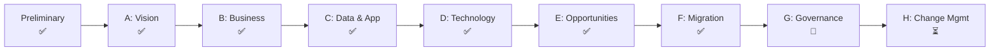

# Nib & Barrel Ltd — TOGAF Architecture Repository

> **Example only.** Nib & Barrel Ltd is a fictional UK online retailer of fountain pens, ballpoints, inks and refills, with an optional laser-engraving service. This repository shows how a small business could organise its architecture work using the **TOGAF Standard, 10th Edition** Architecture Repository.

## Company snapshot

| Attribute | Value |
|---|---|
| Founded | 2019, Bristol, UK |
| Staff | 7 (MD, Ops Lead, 2× Fulfilment, Marketing, Customer Service, part-time Finance) |
| Revenue (FY25) | £1.2m |
| Orders / year | ~26,000 (peak: Nov–Dec, 3× average) |
| Catalogue | ~420 SKUs from 18 suppliers |
| Channels | Own web shop (primary), Amazon UK (secondary) |

## Repository structure

TOGAF defines the Architecture Repository as six classes of content, plus requirements and solutions. Each top-level folder maps to one of these:

| Folder | TOGAF component | What's in it |
|---|---|---|
| [`00-architecture-metamodel`](00-architecture-metamodel/) | Architecture Metamodel | Tailored content metamodel, entity types, ID conventions |
| [`01-architecture-capability`](01-architecture-capability/) | Architecture Capability | Principles, charter/governance, tailored ADM, maturity |
| [`02-architecture-landscape`](02-architecture-landscape/) | Architecture Landscape | Strategic, Segment and Capability architectures (baseline + target) |
| [`03-standards-information-base`](03-standards-information-base/) | Standards Information Base (SIB) | Technology standards, legal and regulatory obligations |
| [`04-reference-library`](04-reference-library/) | Reference Library | Reference models, patterns, templates |
| [`05-governance-log`](05-governance-log/) | Governance Log | Decisions (ADRs), compliance assessments, dispensations |
| [`06-architecture-requirements`](06-architecture-requirements/) | Architecture Requirements Repository | Requirements catalogue, architecture contracts |
| [`07-solutions-landscape`](07-solutions-landscape/) | Solutions Landscape | Solution Building Blocks (SBBs) in use or planned |

## Current architecture engagement

**"Project Quill": re-platforming and engraving at scale** (ADM cycle 2, started 2026-04)

Start reading here:
1. [Architecture Vision](02-architecture-landscape/strategic/architecture-vision.md): why we're changing
2. [Architecture Principles](01-architecture-capability/architecture-principles.md): how we decide
3. [Architecture Roadmap](02-architecture-landscape/strategic/architecture-roadmap.md): what changes and when
4. [Decision Log](05-governance-log/decision-log.md): what we decided and why

## Conventions

- Every architecture element has a stable ID (see [ID conventions](00-architecture-metamodel/content-metamodel.md#id-conventions)), and documents refer to each other by ID.
- Every document has a **Status**: `Draft` → `Approved` → `Superseded`.
- Diagrams use Mermaid so they render on GitHub/GitLab and live alongside the text they describe.
- The Architecture Board approves changes to `Approved` documents (see [charter](01-architecture-capability/architecture-charter.md)).
