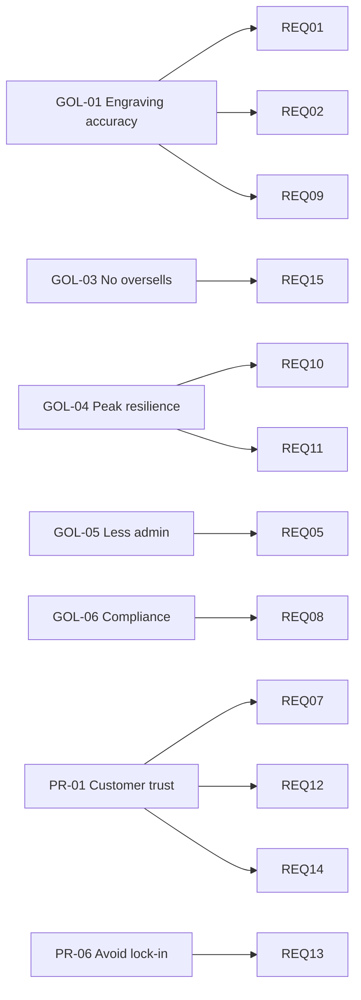

# Architecture Requirements Catalogue

| Status | Owner | Version | Date |
|---|---|---|---|
| Approved | Architecture Lead | 1.5 | 2026-10-19 |

This catalogue holds only the requirements the Architecture Board has authorised. Each one was promoted from a record in the [Requirements Repository](../../requirements-repository/), which keeps the full history, stakeholder source and acceptance criteria. The **Source record** column gives that record's ID. Change the source record, not this table, and promote changes through a change request.

Type: **F** functional · **NF** non-functional · **C** constraint (legal/standard). Priority: MoSCoW.

| ID | Requirement | Type | Priority | Source | Source record | Satisfied by | Verified in | Status |
|---|---|---|---|---|---|---|---|---|
| REQ-01 | Customers can see a live preview of engraving text and font before adding to basket | F | Must | GOL-01 | RQ-003 | SBB-01a (preview app) on APP-01 | CA-2026-002 | Met (pilot) |
| REQ-02 | Engraving text is validated at capture: max length per SKU, supported characters only, no profanity filter bypass | F | Must | GOL-01, PR-01 | RQ-004 | SBB-01a, APP-09 re-validates | CA-2026-002 | Met (pilot) |
| REQ-03 | Storefront and engraving preview meet WCAG 2.2 AA | NF | Should | LEG-08 | RQ-020 | APP-01 theme, SBB-01a | CA-2026-002 | Partially met |
| REQ-04 | Checkout clearly states that personalised items are exempt from the 14-day cancellation right | C | Must | LEG-04 | RQ-021 | APP-01 checkout | CA-2026-001 | Met |
| REQ-05 | Refunds issued within 14 days and reflected in Xero the same day | F | Must | LEG-05, GOL-05 | RQ-014 | INT-02 | CA-2026-001 | Met |
| REQ-06 | Financial and order records retained 6 years in MTD-compatible software | C | Must | LEG-06 | RQ-022 | APP-01, APP-03 | CA-2026-001 | Met |
| REQ-07 | Payment card data never enters systems we operate (SAQ A scope) | C | Must | LEG-03, PR-01 | RQ-023 | APP-02 hosted checkout | CA-2026-001 | Met |
| REQ-08 | Marketing consent captured unticked-by-default with source + timestamp; DSAR/erasure completed within 7 days across all systems | C | Must | LEG-01, LEG-02, GOL-06 | RQ-024 | APP-01, APP-05, BP-09 runbook | Quarterly drill | Met (drill 2026-10-01: 3 days) |
| REQ-09 | Engraving text purged 90 days after delivery | C | Must | LEG-01 (minimisation) | RQ-025 | APP-09 scheduled job | CA-2026-002 | Met |
| REQ-10 | Storefront ≥ 99.9% available Nov–Dec; an office outage must not stop online selling | NF | Must | GOL-04, PR-05 | RQ-008 | TEC-02, TEC-09, PAT-02 | Q4 report | In progress |
| REQ-11 | Handle 300 orders/day and 70 engraved orders/day (3× average) without process change; capacity tested every September | NF | Must | PR-05 | RQ-009 | APP-01, APP-09, staffing plan | CA-2026-001 | Met |
| REQ-12 | All staff access via Google SSO + MFA where the product supports it | NF | Must | PR-01, STD-05 | RQ-026 | TEC-05 | CA-2026-001 | Met (DSP-002 exception) |
| REQ-13 | Weekly open-format export of every system of record; restore drill twice a year. RPO: 7 days (SaaS) / 24 h (APP-09) | NF | Must | PR-06 | RQ-027 | PAT-03, TEC-07, D1 PITR | CA-2026-001 | Met |
| REQ-14 | Custom webhook consumers verify HMAC signatures and are idempotent on order ID | NF | Must | PR-01 | RQ-028 | APP-09 | CA-2026-002 | Met |
| REQ-15 | Amazon stock reflects Shopify within 15 minutes; dispatch confirmation sent within the stated handling time | F | Must | GOL-03, LEG-07 | RQ-029 | APP-08, INT-01 | WP-02 acceptance | In progress |

## Traceability: goals → requirements

The full trace, from stakeholder request to verified solution asset, is in the Requirements Repository's [traceability matrix](../../requirements-repository/06-traceability/traceability-matrix.md).

## Change log
| Date | Change | By |
|---|---|---|
| 2026-05-14 | REQ-01..REQ-12 baselined | Architecture Lead |
| 2026-06-18 | REQ-13, REQ-14 added (from ADR-006) | Fractional architect |
| 2026-07-02 | REQ-15 added (Amazon policy review, CR-001) | Ops Lead |
| 2026-10-09 | Status updates after CA-2026-002 | Architecture Lead |
| 2026-10-19 | "Source record" column added, linking each REQ to its Requirements Repository record (RQ-nnn); no requirement changed | Architecture Lead |
