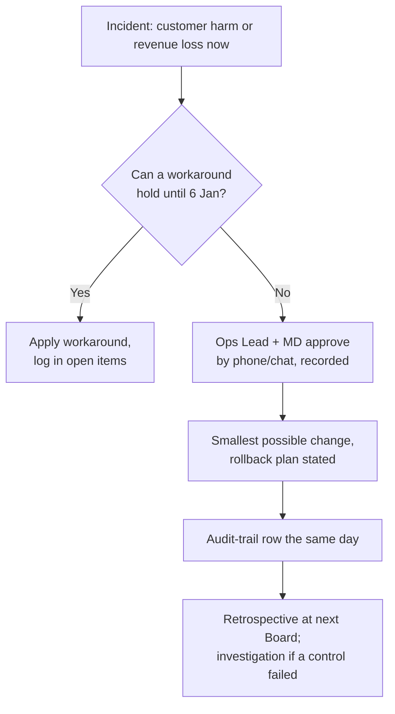

# POL-04: Change Freeze Policy

| Status | Owner | Version | Approved | Date |
|---|---|---|---|---|
| Approved | Operations Lead | 1.1 | BM-2026-10-08 | 2026-10-08 |

## Purpose

About 38% of annual revenue arrives between 1 November and 23 December ([PR-05](../../../architecture-repository/01-architecture-capability/architecture-principles.md#pr-05-design-for-peak-pay-for-average)). The WooCommerce outage on Black Friday 2025 cost an estimated £14k (DRV-03). During peak, the business needs stability more than it needs improvements.

## 1. Freeze window

**1 November to 5 January** every year. For 2026–27: **2026-11-01 00:00 to 2027-01-05 23:59**.

The window is shown in the [roadmap](../../../architecture-repository/02-architecture-landscape/strategic/architecture-roadmap.md#3-transition-architectures) and in the [governance calendar](../governance-calendar.md).

## 2. What is frozen

Production changes to any system in the order path:
- Shopify (APP-01), including theme, apps, checkout, shipping profiles and fulfilment-hold rules;
- payments (APP-02);
- Click & Drop (APP-04);
- the marketplace connector and Amazon listings set-up (APP-07/08);
- the Engraving Queue (APP-09) and the engraving PC (TEC-03);
- DNS and Cloudflare (TEC-04, TEC-06);
- fulfilment endpoints (TEC-08) and the office network (TEC-09).

Also frozen: installing or removing any app, plugin or integration, and adding a new vendor.

## 3. What is allowed during the freeze

| Allowed | Condition |
|---|---|
| **Security fixes** (vendor patches, credential rotation, revoking access) | Ops Lead approves; logged in the audit trail the same day |
| **Content changes**: products, prices, stock, campaigns, help pages | Normal business operations, not architecture changes |
| **Marketing changes** in Klaviyo (APP-05) and helpdesk changes in Gorgias (APP-06), such as flows, segments and macros | Must not change consent capture, the integration settings or data retention |
| **Decommissioning a system that is already read-only and outside the order path** (added in v1.1) | Must already be on the approved roadmap, the final export must be verified first, and it must not happen during the week of Black Friday or Cyber Monday. Examples: Mailchimp closure 2026-11-20 (GA-006); WooCommerce decommission 2026-12-14 (GA-007). |
| **Data deletion under retention rules** (e.g. the REQ-09 purge job) | Already scheduled; no code change |
| **Governance work** with no production change: post-implementation compliance assessments, Board decisions, design work, staging builds | — |

## 4. Emergency change

An emergency change is one needed to stop customer harm or revenue loss that is happening **now**, such as a broken checkout or an integration silently dropping orders.

If either approver is unavailable for 2 hours, the other approves alone and the next Board reviews the decision.

## 5. Before the freeze

The [peak readiness checklist](../../../solutions-repository/) (RB-05 in the solutions repository) must be complete by **25 October**. That includes the September capacity test (REQ-11), confirmed seasonal staffing (RQ-041), 4G failover tested, and no open "blocking" conditions.

## 6. After the freeze

Work deferred by the freeze is scheduled from **2027-01-06**. Pre-go-live compliance assessments for that work take place in the last week of the freeze ([POL-02](POL-02-compliance-review-procedure.md)). For example, CA-2026-004 is on 2027-01-07 for the Engraving Queue rollout on 2027-01-11.

## Change log

| Version | Date | Change |
|---|---|---|
| 1.0 | 2026-04-23 | First version, approved with the Statement of Architecture Work (ADR-003) |
| 1.1 | 2026-10-08 | §3: allow decommissioning of read-only systems outside the order path, so that the Mailchimp closure (2026-11-20) and the WooCommerce decommission (2026-12-14) can keep their dates |
