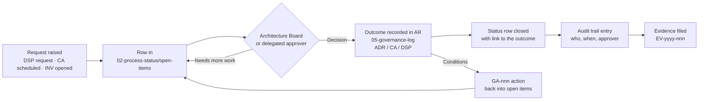
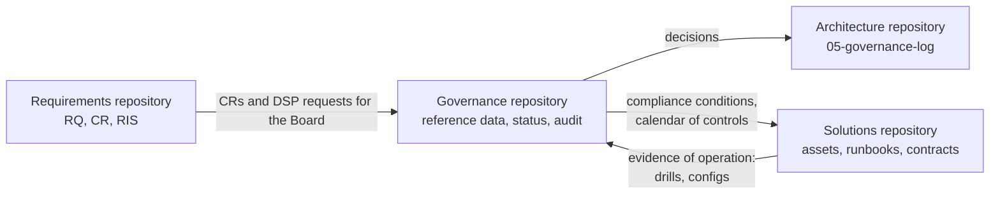

# Nib & Barrel Ltd — TOGAF Governance Repository

> **Example only.** Nib & Barrel Ltd is a fictional UK online retailer of fountain pens, ballpoints, inks and refills, with an optional laser-engraving service. This repository shows how a small business could organise its architecture work using the **TOGAF Standard, 10th Edition** governance repository.

| Status | Owner | Version | Date |
|---|---|---|---|
| Approved | Architecture Lead (Ops Lead) | 1.0 | 2026-10-19 |

## Purpose

The governance repository is the store behind our governance framework. It holds what we need to **run** governance day to day: the rules we follow, the requests that are still open, and the evidence that we did what we said we would.

It is **not** one of the eight Architecture Repository components. Architecture outcomes such as decisions, compliance assessments and dispensations are recorded in the [Governance Log](../architecture-repository/05-governance-log/) of the Architecture Repository. This repository references those records and never copies them (see [the one-store rule](#the-one-store-rule)).

## Structure

| Folder | TOGAF content class | What's in it |
|---|---|---|
| [`01-reference-data`](01-reference-data/) | **Reference data**: procedures, guidance and instructions used during governance | [Policy register](01-reference-data/policy-register.md), [policies POL-01..08](01-reference-data/policies/), [checklists](01-reference-data/checklists/), [governance calendar](01-reference-data/governance-calendar.md) |
| [`02-process-status`](02-process-status/) | **Process status**: the live state of every governance process | [Open items dashboard](02-process-status/open-items.md), [dispensation requests](02-process-status/dispensation-requests/), [investigations](02-process-status/investigations/), [next Board agenda](02-process-status/board-agenda-2026-11-05.md) |
| [`03-audit-information`](03-audit-information/) | **Audit information**: immutable record of completed governance actions | [Audit trail](03-audit-information/audit-trail.md), [Board minutes](03-audit-information/board-minutes/), [evidence index](03-audit-information/evidence-index.md), [monitoring reports](03-audit-information/monitoring-reports/) |

## Governance processes supported

| TOGAF governance process | What it means here | Reference data | Process status | Audit information |
|---|---|---|---|---|
| **Policy management and take-on** | Adopting, reviewing and retiring policies, principles and standards | [Policy register](01-reference-data/policy-register.md); principles and SIB stay in the [Architecture Repository](../architecture-repository/01-architecture-capability/architecture-principles.md) | Policies due for review ([calendar](01-reference-data/governance-calendar.md)) | Approval refs in the [audit trail](03-audit-information/audit-trail.md) |
| **Compliance** | Checking solutions against the architecture before and after go-live | [POL-02](01-reference-data/policies/POL-02-compliance-review-procedure.md), [go-live checklist](01-reference-data/checklists/go-live-readiness.md) | Scheduled CA-2026-003/004/005 in [open items](02-process-status/open-items.md) | Completed CAs in the [governance log](../architecture-repository/05-governance-log/compliance-assessments/), evidence in the [index](03-audit-information/evidence-index.md) |
| **Dispensation** | Time-limited exceptions to principles or standards | [POL-03](01-reference-data/policies/POL-03-dispensation-policy.md) | [DSP-003 request](02-process-status/dispensation-requests/DSP-003-woocommerce-extension.md) | Granted DSPs in the [dispensations register](../architecture-repository/05-governance-log/dispensations.md) |
| **Monitoring and reporting** | Tracking goals, KPIs and recurring controls | [Governance calendar](01-reference-data/governance-calendar.md) | Overdue controls in [open items](02-process-status/open-items.md) | [Quarterly reports](03-audit-information/monitoring-reports/) |
| **Business control** | Making sure the business operates within its policies; investigating breaches | [POL-07](01-reference-data/policies/POL-07-information-security-baseline.md), [POL-04](01-reference-data/policies/POL-04-change-freeze-policy.md) | [INV-2026-01](02-process-status/investigations/INV-2026-01-amazon-oversells.md) | Closed investigations and the [audit trail](03-audit-information/audit-trail.md) |
| **Environment management** | Running the repositories and governance tooling themselves | [POL-06](01-reference-data/policies/POL-06-access-control.md), [POL-08](01-reference-data/policies/POL-08-governance-records-retention.md) | Quarterly access review due dates | [Access review evidence](03-audit-information/evidence-index.md) |

## The one-store rule

At our size, the governance log and the governance repository must behave as **one store**. Two parallel records of the same decision would drift apart. So each kind of record has exactly one home:

| Record | Home | Referenced from |
|---|---|---|
| ADRs, minor decisions | AR [decision log](../architecture-repository/05-governance-log/decision-log.md) | Minutes, audit trail |
| Compliance assessments (CA-yyyy-nnn) | AR [compliance assessments](../architecture-repository/05-governance-log/compliance-assessments/) | Open items (while scheduled), audit trail |
| Granted dispensations (DSP-nnn) | AR [dispensations register](../architecture-repository/05-governance-log/dispensations.md) | Calendar (expiry reminders), audit trail |
| Dispensation **requests** before a decision | Here: [`02-process-status/dispensation-requests/`](02-process-status/dispensation-requests/) | Board agenda |
| Change requests and impact statements | [Requirements repository](../requirements-repository/) | Board agenda, open items |
| Policies, procedures, checklists | Here: `01-reference-data/` | — |
| Board minutes, investigations, attestations, drills, access reviews | Here: `03-audit-information/` | — |
| Runbooks, configuration baselines, contracts | [Solutions repository](../solutions-repository/) | Evidence index |

Lifecycle of a governance item:

## Rules

1. **Append-only audit information.** Rows in the [audit trail](03-audit-information/audit-trail.md) and the [evidence index](03-audit-information/evidence-index.md) are never edited or deleted. A correction is a new row that references the row it corrects.
2. **Identity on every action.** Every closed item records the actor and the approver by role, with an ISO 8601 date (and a time for audit-trail events).
3. **No self-approval.** Nobody approves their own request, dispensation or compliance assessment ([POL-06](01-reference-data/policies/POL-06-access-control.md)).
4. **Every exception expires.** Dispensations have an expiry date and a reminder in the [calendar](01-reference-data/governance-calendar.md) ([POL-03](01-reference-data/policies/POL-03-dispensation-policy.md)).
5. **Evidence by pointer.** Evidence files live on the restricted shared drive `NB-Governance/Evidence/`. This repository holds only the index, never personal data, secrets or screenshots of customer records.

## Access

| Who | Access |
|---|---|
| Architecture Board voting members (MD, Ops Lead, Finance Manager) | Write: merge to `main` |
| Fractional architect | Write: open pull requests; cannot merge their own |
| All staff | Read |
| Contractors (e.g. AC-001) | Read only for the items that concern them, on request |

Write access is controlled by GitHub branch protection and code owners (STD-10). The register of who holds which right, and how it is reviewed each quarter, is in [POL-06](01-reference-data/policies/POL-06-access-control.md).

## Relationship to the other repositories

