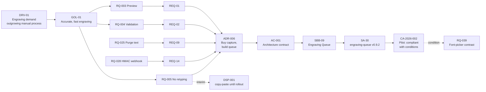

# Requirements Traceability

| Status | Owner | Version | Date |
|---|---|---|---|
| Approved | Architecture Lead (Ops Lead) | 1.2 | 2026-10-19 |

Traceability runs across the three repositories. Each hop is recorded by ID only:

**requirement record (RQ, here) → architecture requirement (REQ, AR) → building block (APP/SBB, AR) → solution asset (SA, solutions repository) → verification (CA, AR governance log) → decisions and exceptions (ADR/DSP, AR governance log)**

## 1. Promoted requirements

| RQ (source record) | REQ (AR) | Satisfied by (AR) | Solution assets | Verified in | Decisions / exceptions | REQ status (AR) |
|---|---|---|---|---|---|---|
| RQ-003 | REQ-01 | SBB-01a on APP-01 | SA-23 | CA-2026-002 | ADR-006 | Met (pilot) |
| RQ-004 | REQ-02 | SBB-01a, APP-09 | SA-23, SA-30, SA-33 | CA-2026-002 | ADR-006 | Met (pilot) |
| RQ-020 | REQ-03 | APP-01 theme, SBB-01a | SA-32, SA-23 | CA-2026-002 ⚠️ | — (RQ-039 open) | Partially met |
| RQ-021 | REQ-04 | APP-01 checkout | SA-20 | CA-2026-001 | ADR-004 | Met |
| RQ-014 | REQ-05 | INT-02 | SA-10 | CA-2026-001 | ADR-005 | Met |
| RQ-022 | REQ-06 | APP-01, APP-03 | SA-20, SA-10 | CA-2026-001 | ADR-005 | Met |
| RQ-023 | REQ-07 | APP-02 hosted checkout | SA-14 | CA-2026-001 | ADR-004 | Met |
| RQ-024 | REQ-08 | APP-01, APP-05, BP-09 | SA-11, RB-01 | Quarterly DSAR drill | ADR-008 | Met |
| RQ-025 | REQ-09 | APP-09 scheduled job | SA-30 | CA-2026-002 | ADR-006 | Met |
| RQ-008 | REQ-10 | TEC-02, TEC-09, PAT-02 | SA-06, SA-20, RB-06 | Q4 report | ADR-004 | In progress |
| RQ-009 | REQ-11 | APP-01, APP-09, staffing plan | RB-05 | CA-2026-001 | — (assumption RQ-041) | Met |
| RQ-026 | REQ-12 | TEC-05 | SA-02, SA-03 | CA-2026-001 | DSP-002 | Met (exception) |
| RQ-027 | REQ-13 | PAT-03, TEC-07, D1 PITR | SA-04, SA-13, RB-02 | CA-2026-001 | — | Met |
| RQ-028 | REQ-14 | APP-09 | SA-30 | CA-2026-002 | ADR-006, ADR-007 | Met |
| RQ-029 | REQ-15 | APP-08, INT-01 | SA-22 | CA-2026-003 (planned) | CR-001 | In progress |

## 2. Reverse map (for the AR catalogue "Source record" column)

| REQ | 01 | 02 | 03 | 04 | 05 | 06 | 07 | 08 | 09 | 10 | 11 | 12 | 13 | 14 | 15 |
|---|---|---|---|---|---|---|---|---|---|---|---|---|---|---|---|
| **RQ** | 003 | 004 | 020 | 021 | 014 | 022 | 023 | 024 | 025 | 008 | 009 | 026 | 027 | 028 | 029 |

## 3. Architectural records not promoted to a separate REQ

These are realised through approved architecture documents (goals, gaps, interfaces) rather than as catalogue entries.

| RQ | Realised in |
|---|---|
| RQ-001, RQ-002, RQ-038 | Vision goals GOL-01..05 |
| RQ-005, RQ-006 | [Capability architecture BC-05](../../architecture-repository/02-architecture-landscape/capability/personalised-engraving.md), AC-001 |
| RQ-010, RQ-011, RQ-013 | Interface catalogue INT-02..04; ADR-005 |
| RQ-015, RQ-016 | GAP-08, GAP-09; ADR-008; WP-05 |

## 4. End-to-end trace: the engraving thread

## 5. Integrity checks (run at each monthly Board)

| Check | Result 2026-10-19 |
|---|---|
| Every REQ-nn cites exactly one RQ source record | ✅ 15/15 |
| Every RQ in status Approved/Implemented with significance Architectural has a REQ, ADR or architecture document link | ✅ |
| Every Rejected / Deferred / Superseded record has a reason | ✅ 6/6 |
| Every Analysed record has a CR or a next step | ✅ RQ-035 (CR-004), RQ-036 (CR-002), RQ-040 (DSP-003) |
| No record deleted since the last baseline (git diff of IDs) | ✅ |
