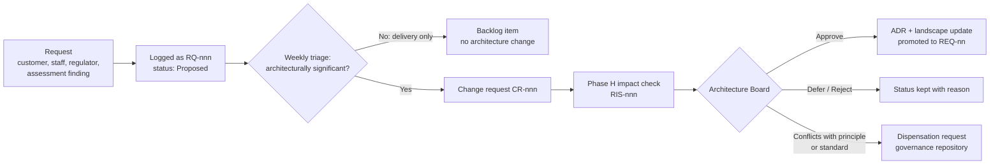
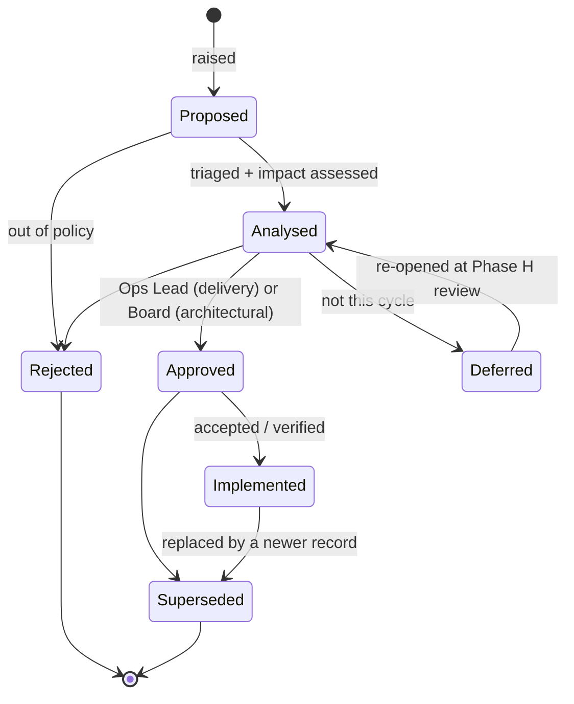

# Nib & Barrel Ltd — TOGAF Requirements Repository

> **Example only.** Nib & Barrel Ltd is a fictional UK online retailer of fountain pens, ballpoints, inks and refills, with an optional laser-engraving service. This repository shows how a small business could run the **TOGAF Standard, 10th Edition** Requirements Management process.

| Status | Owner | Version | Date |
|---|---|---|---|
| Approved | Architecture Lead (Ops Lead) | 1.0 | 2026-10-19 |

## Purpose

This is the store used by **Requirements Management** to record *every* requirement raised during the ADM cycle, from any source and in any status: proposed, analysed, approved, implemented, deferred, rejected or superseded.

It is **not** the architecture requirements repository. That one ([AR `06-architecture-requirements`](../architecture-repository/06-architecture-requirements/requirements-catalog.md)) holds only the binding subset that the Architecture Board has authorised (`REQ-nn`). Each `REQ-nn` points back to its source record here (`RQ-nnn`) by ID, so the two are never copies of each other.

| | Requirements repository (here) | Architecture requirements repository (AR) |
|---|---|---|
| IDs | `RQ-nnn`, `SC-nn`, `CR-nnn`, `RIS-nnn` | `REQ-nn`, `AC-nnn` |
| Content | Everything: business, functional, NFR, constraints, assumptions, change requests | Only Board-authorised, architecturally significant requirements and contracts |
| Statuses | All, including rejected and deferred | Baselined; changed only through a Phase H change request |
| Written by | Anyone can raise; the Ops Lead triages | Architecture Lead, after Board sign-off |
| Size today | 42 records, 6 change requests | 15 requirements, 1 contract |

## Repository structure

| Folder | TOGAF concept | What's in it |
|---|---|---|
| [`01-requirements-management`](01-requirements-management/process.md) | Requirements Management process | Tailored process, cadence, roles, RACI |
| [`02-stakeholder-concerns`](02-stakeholder-concerns/stakeholder-concerns.md) | Stakeholder concerns | SC-01..08, one per stakeholder in the [Vision stakeholder map](../architecture-repository/02-architecture-landscape/strategic/architecture-vision.md#5-stakeholder-map) |
| [`03-requirements-register`](03-requirements-register/register.md) | Requirements repository content | Master register of all `RQ` records; detailed [records](03-requirements-register/records/) for illustrative cases |
| [`04-change-requests`](04-change-requests/change-request-register.md) | Phase H change requests | CR register and individual change requests |
| [`05-impact-assessments`](05-impact-assessments/) | Requirements Impact Statements | RIS-001, RIS-002 |
| [`06-traceability`](06-traceability/traceability-matrix.md) | Traceability | RQ → REQ → building block → compliance assessment → decision |

## How a request is routed

A request is **architecturally significant** if it meets the [charter](../architecture-repository/01-architecture-capability/architecture-charter.md#governance-process) test: it touches a system of record, adds a vendor, or costs more than £2k a year. It is also significant if it changes a principle, standard, interface or data entity.

## Status workflow

## Record attributes

Every `RQ` record has these attributes: ID · statement · rationale · type (B business, F functional, NF non-functional, C constraint, A assumption) · source / raised by · owner · raised date · MoSCoW priority · status · significance (Architectural or Delivery) · affected ADM phases · building blocks · links (GOL, GAP, REQ, CR, ADR, DSP, SBB/SA) · acceptance criteria · change history.

## Rules

1. **Append-only.** Records are never deleted. Rejected, deferred and superseded records keep their reason, so the same request is not reopened from scratch.
2. **Reference, don't copy.** An architecture requirement (`REQ-nn`) cites its source `RQ` by ID. The wording is maintained in one place: the AR, once the requirement is promoted.
3. **Board gate.** Nothing enters the AR requirements catalogue without Architecture Board sign-off.
4. **Stable IDs.** IDs are never reused or renumbered.
5. **Role-based access.** Anyone in the company can raise a request (via the Ops Lead or a GitHub issue). Only the Ops Lead and the fractional architect can change status. Security-sensitive requirements are summarised here, and the detail is kept in the restricted governance evidence store.

## Related repositories

- [Architecture repository](../architecture-repository/README.md): promoted requirements, decisions and the landscape.
- [Solutions repository](../solutions-repository/README.md): the assets (`SA-nn`) that satisfy approved requirements.
- [Governance repository](../governance-repository/README.md): Board agenda, dispensation requests and open actions arising from requirements.
