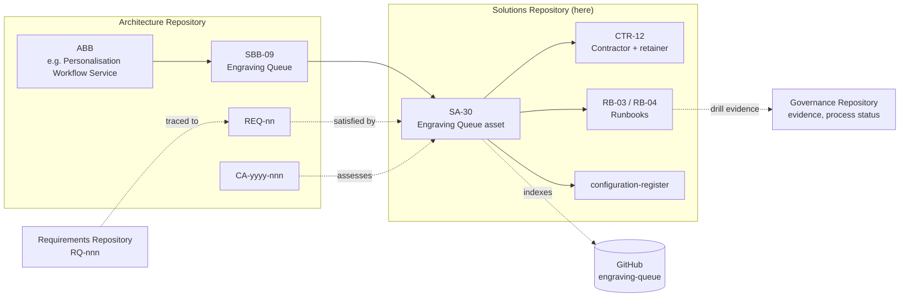

# Nib & Barrel Ltd — TOGAF Solutions Repository

> **Example only.** Nib & Barrel Ltd is a fictional UK online retailer of fountain pens, ballpoints, inks and refills, with an optional laser-engraving service. This repository shows how a small business could organise its architecture work using the **TOGAF Standard, 10th Edition** Solutions Repository.

| Status | Owner | Version | Date |
|---|---|---|---|
| Approved | Architecture Lead (Ops Lead) | 1.0 | 2026-10-19 |

## Purpose

The Solutions Repository holds the **real solution assets** that implement our architecture: the configured SaaS subscriptions, the custom Engraving Queue, contracts, licences and the runbooks we operate them with.

It is **not** the same as the [Solutions Landscape](../architecture-repository/07-solutions-landscape/solution-building-blocks.md) in the Architecture Repository:

| | Solutions Landscape (AR `07-`) | Solutions Repository (here) |
|---|---|---|
| Holds | Architectural *descriptions*: which SBB realises which ABB | The *assets*: configuration, code pointers, contracts, runbooks |
| Example | "SBB-01 Shopify Advanced realises the Commerce Engine ABB" | "SA-20: the store is on Advanced, UK market only, the engraving fulfilment-hold rule is X, the webhooks are Y" |
| ID | `SBB-nn` | `SA-nn` (asset), `CTR-nn` (contract), `RB-nn` (runbook) |
| Changes when | The architecture changes (ADR) | Anything is configured, deployed, renewed or retired |

## Two rules

1. **Federated index, not a copy.** Where an asset already has a version-controlled system of record, this repository only **indexes** it: owner, deployed version, link, lifecycle. The Engraving Queue source lives in `github.com/nib-and-barrel/engraving-queue` ([STD-10](../architecture-repository/03-standards-information-base/technology-standards.md)). We never copy its code here.
2. **For SaaS, the baseline here *is* the record.** A vendor admin screen is not diffable, versioned or reviewable. For every configured SaaS product, the configuration baseline in this repository is the authoritative, version-controlled description of how it *should* be set up. Any change to the live setting must also be made here in the same PR, and drift found during a review is a defect.

## Structure: the Solutions Continuum

Assets are classified from generic to specific, following TOGAF's Solutions Continuum. Reuse runs from the top down.

| Folder | Continuum level | What's in it |
|---|---|---|
| [`01-foundation/`](01-foundation/) | Foundation solutions | DNS, zero-trust access, identity, backup storage, endpoints, office network |
| [`02-common-systems/`](02-common-systems/) | Common systems solutions | Horizontal business apps: accounting, email marketing, helpdesk, bulk export, payments |
| [`03-industry/`](03-industry/) | Industry solutions | Retail-specific: commerce platform, carrier labels, marketplace sync, product personaliser |
| [`04-organisation-specific/`](04-organisation-specific/) | Organisation-specific solutions | Engraving Queue, job-file interface, our theme, the pen product data model |
| [`90-legacy/`](90-legacy/) | (retiring) | Assets being decommissioned |
| [`contracts/`](contracts/) | Commercial | Vendor contracts and licences register (`CTR-nn`) |
| [`runbooks/`](runbooks/) | Operational | How we operate, recover and change assets (`RB-nn`) |
| [`solutions-catalogue.md`](solutions-catalogue.md) | Index | Master list of every `SA-nn` |
| [`configuration-register.md`](configuration-register.md) | CMDB-lite | Environments, deployed versions, last change, freeze status |

## Attributes of every asset record

| Attribute | Meaning |
|---|---|
| ID | `SA-nn`, stable, never reused |
| SBB | The [Solution Building Block](../architecture-repository/07-solutions-landscape/solution-building-blocks.md) it realises (or the `TEC-`/`APP-` ID) |
| Continuum | Foundation / Common systems / Industry / Organisation-specific |
| Owner | One named role, accountable for the asset and its baseline |
| System of record | Where the real thing lives, and whether the baseline here is authoritative (SaaS) or an index (code) |
| Version | Baseline version here, plus the deployed version for code |
| Lifecycle | `Planned` → `Implementing` → `Active` → `Deprecated` → `Retired` |
| Contract / runbooks | `CTR-` and `RB-` links |
| Change refs | ADR / CR / requirement IDs that caused the current baseline |

## No secrets, ever

This repository is readable by all staff and contractors. It **never** contains passwords, API tokens, webhook secrets, private keys, recovery codes or real customer data. Secrets are referenced by vault path only:

```yaml
shopify_admin_token: vault:1Password/Nib & Barrel/Engineering/eq-shopify-admin-token
```

If a secret is ever committed, treat it as compromised: rotate it first, then rewrite history. Report it to the Ops Lead.

## How it links to the other repositories



- **Architecture Repository**: every `SA-nn` points to the SBB it realises. Compliance assessments ([`05-governance-log`](../architecture-repository/05-governance-log/)) assess assets against the architecture.
- **[Requirements Repository](../requirements-repository/)**: requirement records (`RQ-nnn`) trace through architecture requirements (`REQ-nn`) to the assets that satisfy them.
- **[Governance Repository](../governance-repository/)**: holds the evidence from runbook drills (restore, DSAR, access review) and the status of open change and dispensation requests that affect assets.

## Conventions

- One file per asset, named `SA-nn-short-name.md`. Small, closely related assets may share a file.
- Configuration snapshots use fenced YAML. The values are the *intended* settings, not an export.
- A change to an asset baseline is a PR reviewed by the asset owner. If it touches a system of record, adds a vendor or costs more than £2k/yr, it also needs an ADR ([charter](../architecture-repository/01-architecture-capability/architecture-charter.md)).
- During the Q4 change freeze (2026-11-01 → 2027-01-05), baselines can be edited only for security fixes or to record drift.
