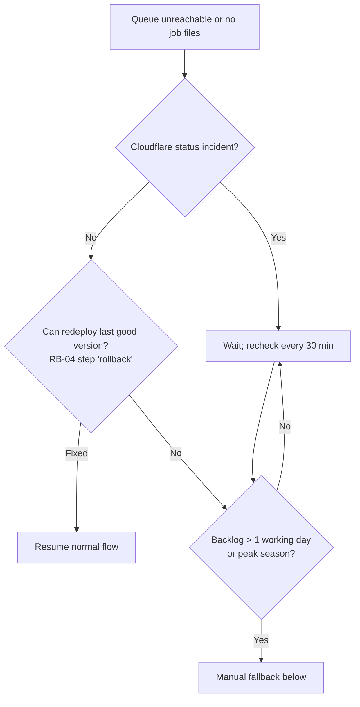

# RB-03: Engraving Queue Outage: Manual Fallback

| Status | Owner | Version | Date |
|---|---|---|---|
| Approved | Ops Lead | 1.0 | 2026-10-09 |

| Implements | Requirement | Applies to |
|---|---|---|
| PAT-02 hold-and-release fallback; the [capability architecture](../../architecture-repository/02-architecture-landscape/capability/personalised-engraving.md) failure mode | REQ-10, PR-01 | [SA-30](../04-organisation-specific/SA-30-engraving-queue.md) unavailable, or the job agent on the engraving PC is not receiving files |

**Safe by design:** if the queue is down, engraved orders stay **on hold** in Shopify and nothing ships incomplete. Customer-facing selling is not affected.

## Decide (Ops Lead, within 30 min)

## Manual fallback
1. Open the order in Shopify admin on a fulfilment Chromebook (filter: fulfilment hold "Awaiting engraving").
2. **Copy-paste** the `_engraving_line_1/2` and `_engraving_font` properties into the laser software. **Never retype them** (the same control as DSP-001).
3. A second person compares the screen to the order **before** the laser runs (4-eyes on every order, not only those over £150).
4. Engrave, check, take a QC photo and attach it to the Shopify order timeline as a comment.
5. Release the fulfilment hold manually in Shopify. The order then flows to Click & Drop (SA-21).
6. Keep a list of the order numbers handled manually. When the queue is back, mark these jobs `Released` with the admin action "Mark manually fulfilled", so that the 90-day purge still runs (REQ-09).
7. Report error counts in the weekly DSP-001 engraving error-rate report.

## After the incident
Log the incident in the [governance repository](../../governance-repository/) audit trail. If it lasted more than 1 working day, raise a defect with the contractor (AC-001 D4: ≤ 1 working-day response during pilot support).
